# CurioMesh: free auto retopology and quad remesh add-on for Blender

**A free, open source Blender retopology add-on. It turns a dense sculpt, scan or high-poly game asset into a clean all-quad, low-poly mesh.**

[](https://github.com/CurioCrafter/CurioMesh/releases/latest)
[](https://github.com/CurioCrafter/CurioMesh/stargazers)

[](https://github.com/CurioCrafter/CurioMesh/releases/latest)
[](https://www.blender.org/download/)
[](LICENSE)

<p align="center">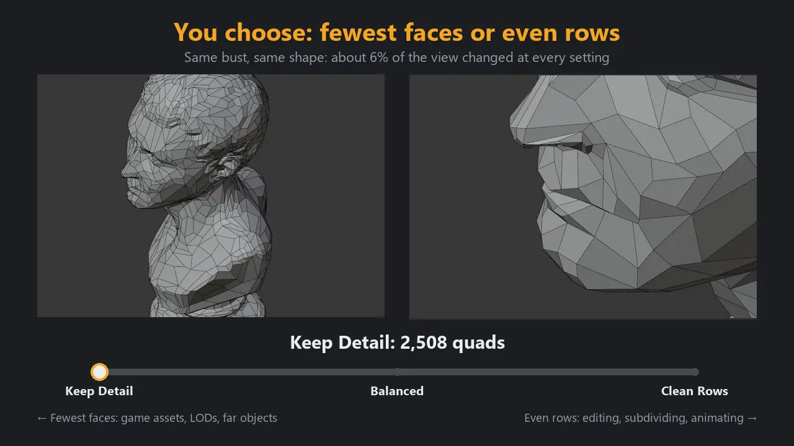</p>

*The same 17,456-face sculpt at every setting, about 6% of the view changed: Keep Detail makes the fewest faces (2,508 quads), Clean Rows makes even rows (14,147 quads). You choose what matters more for the job.*

CurioMesh is an automatic quad retopology add-on for Blender 3.6 to 5.2. Say what the mesh is for, press one button, and it reduces
the model part by part. A camera check compares the result with your original from six sides and tells you how much of the view
changed. Then you redo only the part that still looks wrong. It runs on your PC and uploads nothing.

**Who it is for:** 3D artists, technical artists and game developers who need a lower-poly, all-quad version of a high-poly
model, a sculpt or a photogrammetry scan, and want to fix single parts instead of redoing the whole mesh.

**[Download the add-on](https://github.com/CurioCrafter/CurioMesh/releases/latest)** · [Install it](#install) · [Try it in four steps](#quick-start)

**If CurioMesh saved you time, please [star it on GitHub](https://github.com/CurioCrafter/CurioMesh/stargazers).** It is free and made by one person, and stars are how other artists find it. Something broke? [Open an issue](https://github.com/CurioCrafter/CurioMesh/issues/new) (the add-on's **Report a Problem** button fills in your versions).

<p align="center">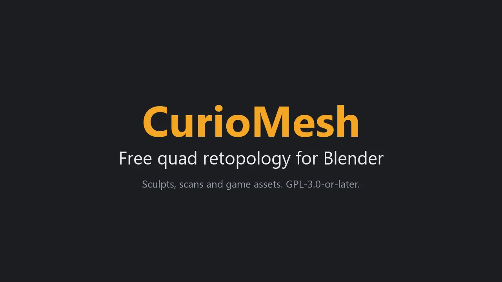</p>

## Contents

| | |
|---|---|
| **Get started** | [Install](#install) · [Quick start](#quick-start) · [Choose a use and a style](#choose-a-use-and-a-style) |
| **The panel, in order** | [Adjust](#adjust) · [Fix](#fix) · [Finish](#finish) |
| **Going further** | [Hard Surface](#hard-surface) · [Shape the flow](#shape-the-flow) · [Parts](#parts) · [Blockout and Hulls](#blockout-and-hulls) · [Pro tab and classic tools](#pro-tab-and-classic-tools) |
| **Trust and speed** | [How it checks results](#how-it-checks-results) · [Results](#results) · [Big scans and small PCs](#big-scans-and-small-pcs) |
| **Around the add-on** | [Without Blender](#without-blender) · [Agent skills](#agent-skills) · [FAQ](#faq) · [Known limits](#known-limits) · [Contributing](#contributing) · [Credits](#credits) · [License](#license) |

**Honest limits up front:** quads can look slanted on smooth surfaces, fine ornaments go jagged at high reduction, it does not find edge
loops for faces and joints on its own, and big scans take minutes, sometimes tens of minutes. See [Known limits](#known-limits).

---

## Install

Each release has a zip for your exact Blender version, plus two all-in-one zips. Get them from the [latest release](https://github.com/CurioCrafter/CurioMesh/releases/latest).

| Your Blender | Download | Install with |
| --- | --- | --- |
| 5.2 LTS, 5.1, 5.0, 4.5 LTS, 4.4, 4.3, 4.2 LTS | `curiomesh-<version>-blender-<your version>-extension.zip` | `Edit > Preferences > Get Extensions > ⌄ > Install from Disk` |
| 4.1, 4.0, 3.6 LTS | `curiomesh-<version>-blender-<your version>-addon.zip` | `Edit > Preferences > Add-ons > Install...` |
| Not sure | `...-blender-4.2-plus-extension.zip` (4.2 and newer) or `...-blender-3.6-plus-addon.zip` (any version from 3.6) | as above |
| 3.5 and older | not supported | |

1. Download the zip that matches your Blender version from the table above. Do not unzip it.
2. In Blender, open the menu from the table (Get Extensions for 4.2 and newer, Add-ons for older versions) and pick the zip.
3. Enable **CurioMesh**.
4. Select a mesh and open `3D View > N-panel > CurioMesh`.

<details>
<summary>Release builds, checksums and tested versions</summary>

The version on extensions.blender.org is Python-only (the site allows no compiled code), so it is slower on big meshes, and its tidiness score uses CC0
reference meshes only. The GitHub zips include the fast native core. `python scripts/build_release.py --blender-listing` builds that zip. Releases are built
by the release workflow from the tag, and each comes with `SHA256SUMS.txt` so you can check your download.

The last full test on every Blender version from 3.6 to 5.2 was for 0.8.0. The checks for this version ran on 3.6 LTS, 4.2 LTS and 5.2 LTS, and most of the work on Auto Segments
was done on 5.2. The viewport overlays draw with Blender's GPU module. If a build cannot draw them, the rest of the add-on keeps working.

</details>

[Back to top](#curiomesh-free-auto-retopology-and-quad-remesh-add-on-for-blender)

## Quick start

The CurioMesh panel shows only what your current step needs: pick a mesh, say what it is for, press Start, then Adjust, Fix and Finish when they can do something.

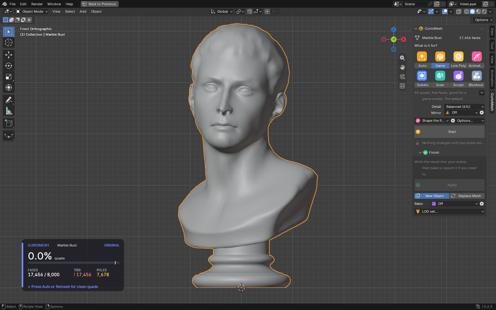

1. Download the zip for your Blender version from the [latest release](https://github.com/CurioCrafter/CurioMesh/releases/latest) ([which one?](#install)).
2. In Blender, install it and enable **CurioMesh**.
3. Select a mesh and open `3D View > N-panel > CurioMesh`.
4. Under **What is it for?** click a tile (**Game** for most models, or **Auto** to let CurioMesh pick), then press **Start**.

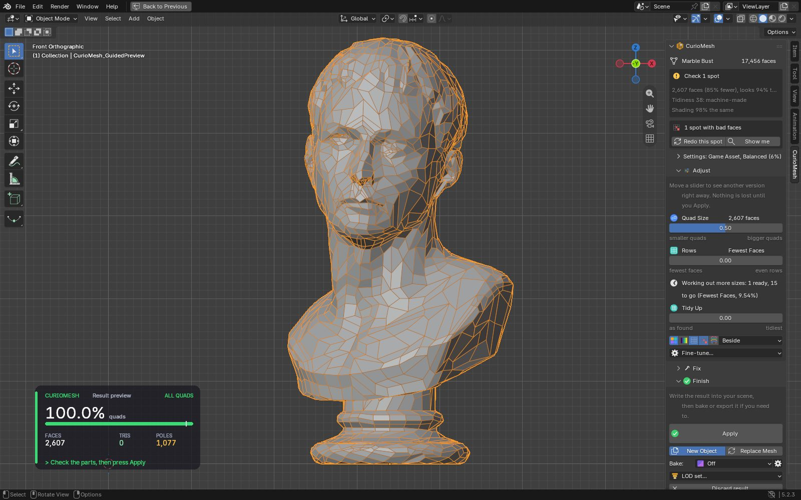

The panel then says how the result turned out and what to do next. A coloured verdict shows whether the result is ready ("Good for game asset", "Check 2 spots" or "5 spots with bad faces left"), with the numbers in grey under it. Drag the sliders under [Adjust](#adjust), fix any bad
spots under [Fix](#fix), and press **Apply** under [Finish](#finish). Nothing changes in your scene until Apply. Every other
setting and the older tools are in the [CurioMesh Pro tab](#pro-tab-and-classic-tools) (the **Pro** button in the panel header).

| Feature | What it does |
|---|---|
| **Auto Segments and the Auto button** | Reduces the whole object to all quads, one loose part at a time, and checks every size from six sides. **Auto** picks the Use and settings for you. |
| **Presets by use** | Low Poly, Game Asset, Animation, Subdivision, Scan Cleanup, Sculpt Base. |
| **Three layout styles** | Keep Detail (fewest faces), Balanced, Clean Rows (even quads in rows). |
| **Know the cost first** | The time on your PC before you press Start, Slow/Heavy tags on heavy options, and a question before long jobs. |

[Back to top](#curiomesh-free-auto-retopology-and-quad-remesh-add-on-for-blender)

## Choose a use and a style

**What is it for?** sets Detail, Method and Output for you. **Layout style** decides what comes first when quads can either follow the shape or run in rows.

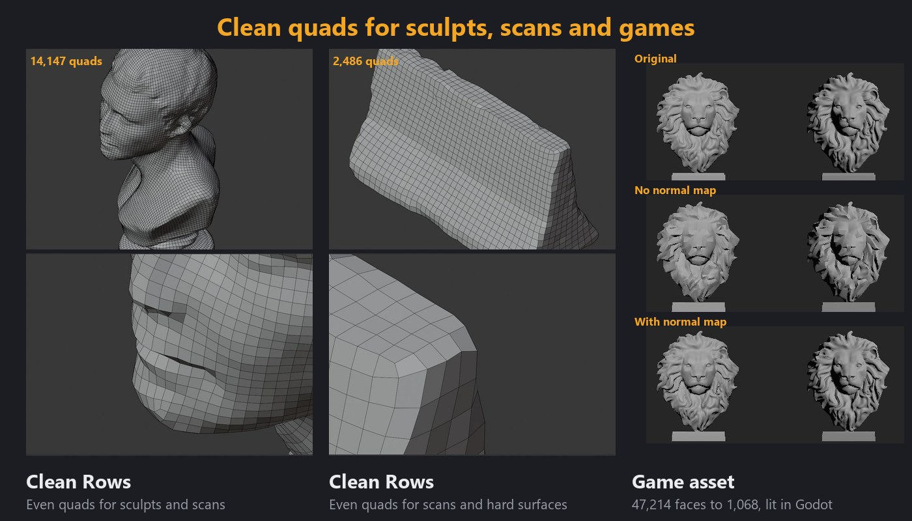

*Clean Rows on a sculpt and on a scan (wireframe), and a 47,214-face sculpt reduced to 1,068 faces with a baked normal map, lit in Godot.*

### Uses

The tiles are Auto, Game, Low Poly, Animation, Subdiv, Scan, Sculpt and Blockout (Hulls is under the small arrow). **Auto** looks at your mesh and the free memory on this PC, picks the Use and
settings, says in plain words why it chose them, and starts. You can still change anything before you press Apply. Change any setting and the Use becomes Custom.

| Use | What it is for |
|---|---|
| Low Poly | The fewest faces for a game prop or a background object. Flat areas collapse into big polygons, then triangles. Small parts may vanish. |
| Game Asset | All quads, few faces. The default. |
| Animation | All quads in even sizes, with more faces so the mesh bends cleanly. Uses a clean cage with the detail in Multires levels, and Redraw Messy Quads. Check eyes, mouth and joints by hand. |
| Subdivision | All quads, with flat panels kept as single large quads so smoothing keeps the shape. Redraw Messy Quads is on. |
| Scan Cleanup | Keeps more detail of a dirty scan. Scans have few truly flat areas, so no flat merging. |
| Sculpt Base | Even, smooth quads to sculpt on. Smoothness over detail. |
| [Hard Surface](#hard-surface), [Blockout and Hulls](#blockout-and-hulls) | Under More Uses. See their own sections. |

Under the Use you can pick a **Method** (Auto, Pairing, Flat Quads, QuadriFlow, Grid Fill, Flow Fill, Field Rows, Tris Only) and an
**Output** of triangles, quads or mixed. The tooltips explain hard edges, UV seams and Surface Fit. **Detail** is one dropdown: Keep Most, Keep a Lot, Balanced, Lighter, Lightest, Custom %, Share of Faces or Exact Face Count.

<details>
<summary>The same bust with each Use</summary>

| Use | CurioMesh faces | Triangles left | View changed | Wire pictures |
|---|---:|---:|---:|---|
| Low Poly | 1,492 | 1,492 | 9.4% | [before and after](docs/images/bust_low_poly.jpg) |
| Game Asset (default) | 2,508 | 0 | 6.0% | [before and after](docs/images/marble_bust_01.jpg) |
| Animation | 4,228 | 0 | 10.7% | [before and after](docs/images/bust_animation.jpg) |
| Subdivision | 7,932 | 0 | 1.4% | [before and after](docs/images/bust_subdiv.jpg) |
| Scan Cleanup | 5,638 | 0 | 1.9% | [before and after](docs/images/bust_scan.jpg) |
| Sculpt Base | 3,402 | 0 | 5.9% | [before and after](docs/images/bust_sculpt.jpg) |

The Animation row shows a higher View changed (10.7%) because its level 0 is a clean cage that keeps its own rough outline, and the Multires levels bring the shape back. That cage has 38 folded quads out of 4,228. Low Poly leaves every face a triangle, as it should, and changes 9.4% of the view.

</details>

### Layout styles

Pick what comes first when the two disagree:

- **Keep Detail** holds the amount of change you allow with the fewest faces. The quads follow the shape, so on smooth surfaces they can look slanted. Use it for hard-surface props and game assets where face count matters most.
- **Balanced** holds the same change with far fewer irregular vertices, by splitting every quad. It costs more faces.
- **Clean Rows** makes even, square quads in long rows. Use it for sculpts, scans and anything an artist will edit, subdivide or animate. It costs more visible change, and small sharp detail softens.

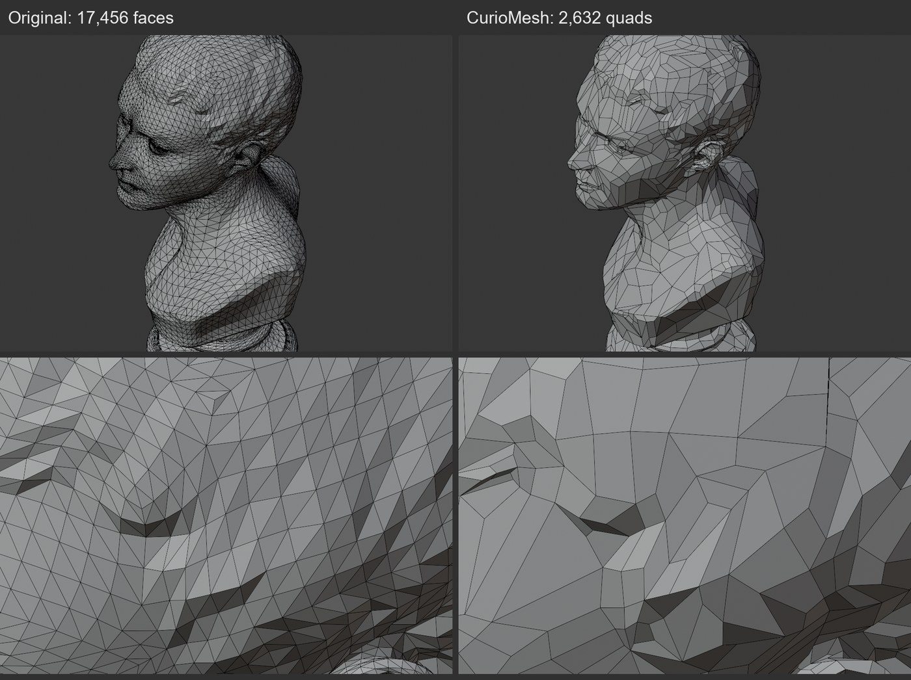
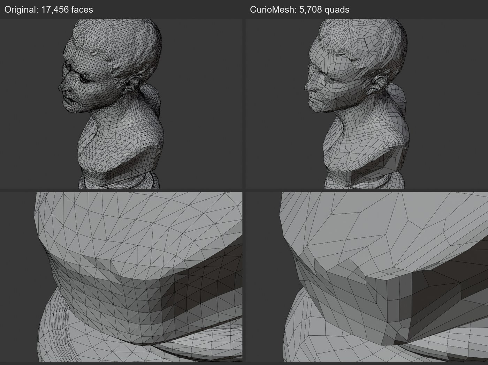
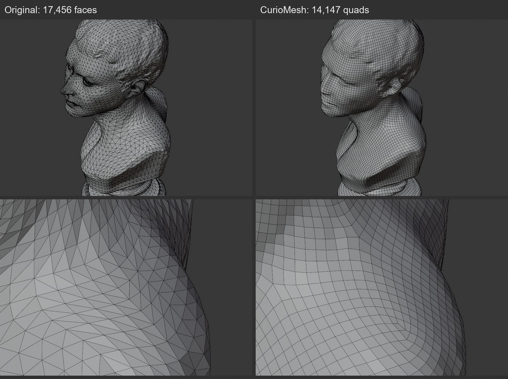

| Style | Model | CurioMesh quads | View changed | Tidiness | Wire pictures |
|---|---|---:|---:|---:|---|
| Keep Detail | Marble bust | 2,508 | 6.0% | 27 | [before and after](docs/images/marble_bust_01.jpg) |
| Balanced | Marble bust | 3,920 | 6.0% | 68 | [before and after](docs/images/bust_balanced.jpg) |
| Clean Rows | Marble bust | 14,147 | 5.7% | 97 | [before and after](docs/images/bust_rows.jpg) |
| Keep Detail | Concrete road barrier | 987 | 5.9% | 16 | [before and after](docs/images/concrete_road_barrier.jpg) |
| Balanced | Concrete road barrier | 1,195 | 6.1% | 51 | [before and after](docs/images/barrier_balanced.jpg) |
| Clean Rows | Concrete road barrier | 2,486 | 6.2% | 99 | [before and after](docs/images/barrier_rows.jpg) |

*Tidiness* is a number from 0 to 100 for how close the quads' layout is to hand-made meshes. Higher is tidier. Credits and limits are in
[`docs/PATTERN_SOURCES.md`](docs/PATTERN_SOURCES.md). Read it next to View changed, because a tidy grid can still miss the surface.

[Back to top](#curiomesh-free-auto-retopology-and-quad-remesh-add-on-for-blender)

## Adjust

After a run, three sliders sit under the result. Use them to trade face count, layout and tidiness without starting over.
Dragging one is a live preview: the mesh on screen changes at once and Blender stays usable (1 to 4 ms per step on the bust and the compressor).

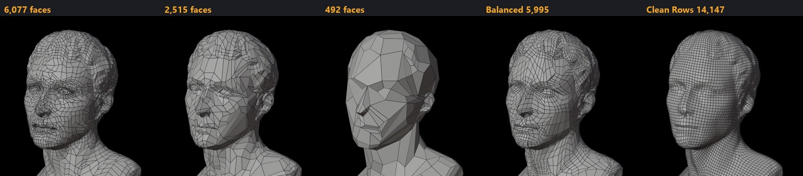

| Slider | What it does |
|---|---|
| **Quad Size** | Smaller quads to the left, bigger to the right. Each step is a full result of the search at another Detail, so it keeps the shape and puts its faces where the shape needs them. The other sizes are worked out in the background while you look; until one is ready, the nearest finished size is shown. |
| **Rows** (called Organization before 0.9.8) | Fewest faces (Keep Detail) to the left, Balanced in the middle, even rows (Clean Rows) to the right. On models of many loose pieces, the pieces change over one at a time, so the change is gradual. |
| **Tidy Up** | About the same faces, laid out tidier: messy spots round poles redrawn as grids, then the quads settled into straighter, more even rows. A line under it shows Tidiness, Loop Quality, poles and how much more of the view changed. |
| **Loop Flow** | A view switch that draws each edge loop in its own colour, and its poles as dots (blue: three edges, red: five or more). |
| **Bigger Quads / Smaller Quads** | Change only the parts you select in [Review Segments](#parts). |
| **Fine-tune...** | The three Tweak sliders and Most Detail Loss. Rows on Round Areas (how readily round, smooth areas become rows), Flat Area Size (how big the quads inside flat areas may get) and Avoid Poles (Keep Detail). Each reruns the search with Auto-Update and takes seconds on a bust. |

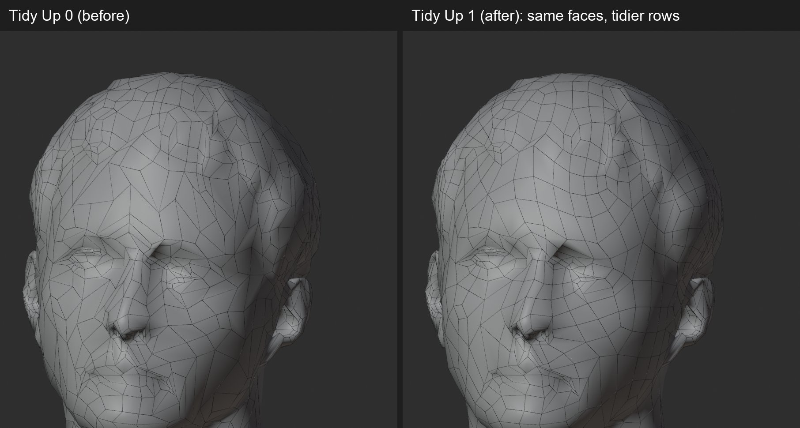

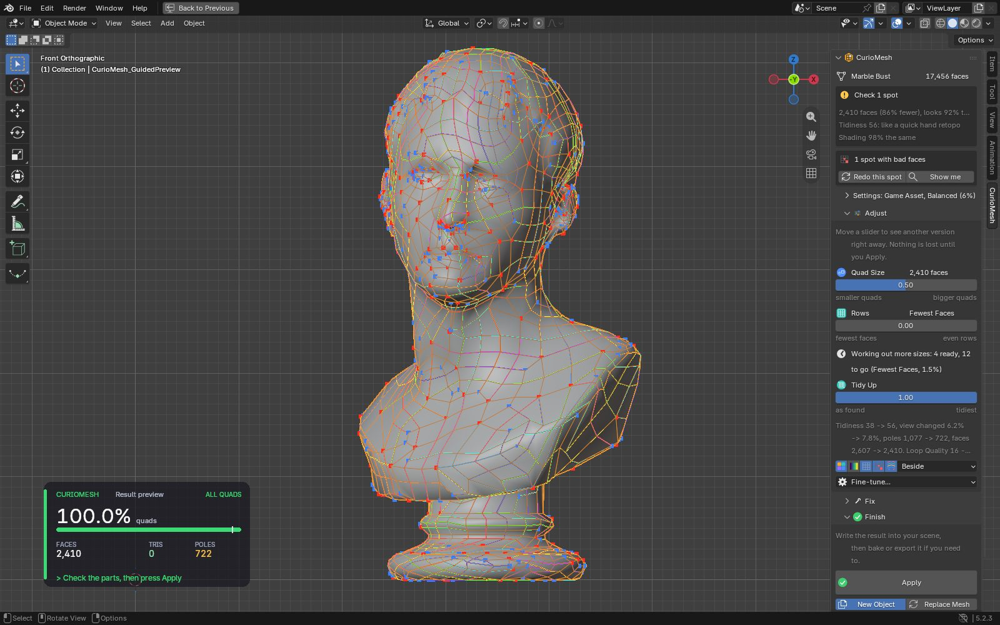

The panel warns when a slider would replace parts you changed by hand. The sizes take a while to work out on big models (minutes per size on an 80,000-face model). Moving a slider after a per-part edit puts
back a whole size, so that edit is lost.

<details>
<summary>Numbers: Quad Size on the marble bust, and Tidy Up details</summary>

| Quad Size on the marble bust | Finest | | Auto | | Coarsest |
|---|---:|---:|---:|---:|---:|
| Faces | 6,077 | 3,733 | 2,515 | 983 | 492 |
| View changed | 1.6% | 4.1% | 6.5% | 14.8% | 23.6% |

Tidy Up works out four strengths in the background the first time you move it (a few seconds on a bust, under ten on a 15,000-face machine); after that dragging only swaps meshes. 0.25 redraws the messy patches around poles as plain grids and spins edges to walk the poles left together; higher strengths let the quads settle into even rows, held on your mesh, with hard edges, borders and the mirror seam kept where they are, and the top of the slider straightens the loops. A mirrored result is tidied on one half and mirrored again, so the seam stays exact. **Most Detail Loss** stops Tidy Up at this much more change of the view than at 0.

Loop Quality is a 0 to 100 score of the edge loops the way an artist reads them (straight rows, no zig-zags, evenly stacked loops, even quad widths, square corners, few and spread-out poles, few loops that die after a few quads). On the bust it went from 16 to 32. Honest limit: on the bust the top of the slider adds only about 3 Loop Quality points over the settle, because about a third of the corners are poles and the loops are three or four quads long.

Measured at Tidy Up 1 on five free test models: Tidiness up by 12 to 18 points on the bust, lion, horse (with Symmetrize) and barrier and by 4 on the compressor; poles down by a third on the organic ones; 4 to 13% fewer faces; the view changed by 0.8 to 1.4 points more; Issue Finder totals down on all five, though 7 to 80 bent quads appear where there were almost none.

</details>

### Reduce To a number of faces

Set **Aim** to Reduce To and give a percentage of your faces or a face count. The result lands within about 10% of it unless the parts
cannot go that low, and the summary tells you how much of the view changed. On the bust, asking for 1,500 faces gave 1,491
with 11.2% of the view changed.

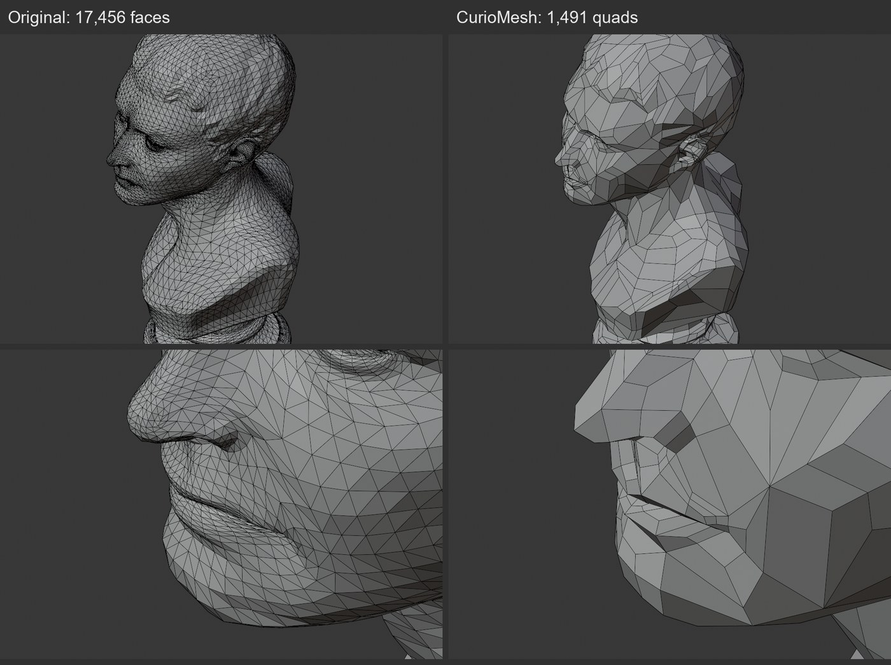

[Back to top](#curiomesh-free-auto-retopology-and-quad-remesh-add-on-for-blender)

## Fix

The result can have bad spots: faces turned inward, folded over or crossing. Fix walks through them one at a time. Use it when the verdict says "Check 2 spots" or similar.

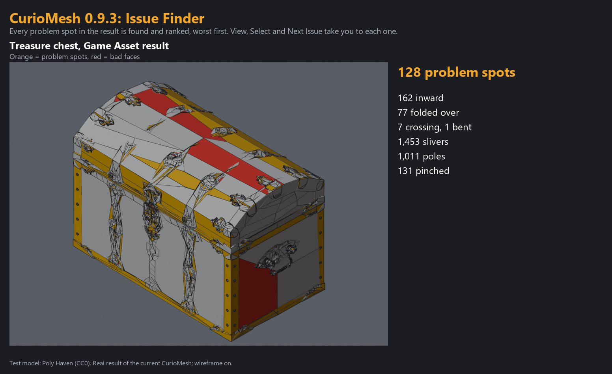

- **Issue Finder** counts faces turned inward, folded over or crossing, and shows them in red. Bad faces are not rare on hard-surface models: on the drill press 203 inward, 180 folded and 14 crossing among 16,809 faces. Models of many small parts have about 6 to 22 such faces per 1,000, smooth sculpts 0.1 to 0.8.
- **Redo this spot** remakes the part under the spot with smaller quads.
- **Keep original here** puts the original faces back at that spot. It shows the faces it adds and asks first. **Put reduced back** undoes it. Keep Original on all parts also shows its cost and asks.
- The part list, a short part card, and the hand tools and part finder are in two popovers.

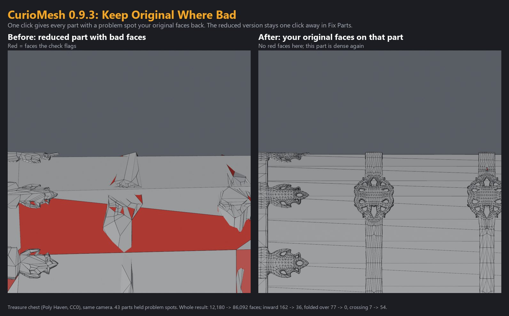

After Apply, a line in the result says "New problems: 22 faces lying on each other" instead of "No new problems" when faces lie on each other.

### Redo inside shapes (Live Boolean)

Put boxes, spheres or any closed mesh over parts of the result and combine them with Union, Subtract or Intersect. Only the faces inside
are redone as you move the shapes. A slider from Organized to Detailed sets the new quad size. Everything outside stays as it was.
A redo is refused when it would make more faces than it replaces, and the panel says so.

### Show it how

Fix a spot by hand, press **Remember This Fix**, and CurioMesh can find the same quad pattern in later results. It is stored on your PC.

[Back to top](#curiomesh-free-auto-retopology-and-quad-remesh-add-on-for-blender)

## Finish

Apply writes the result to your scene. Bake, LOD sets and export are here too, for game assets. The Finish section has one big **Apply**, **New Object / Replace Mesh**, the only **Bake** row (its size and texture sets behind the gear), **LOD set...** and **Discard**. Export for game and the star and report buttons appear after Apply. Nothing changes in your scene until Apply.

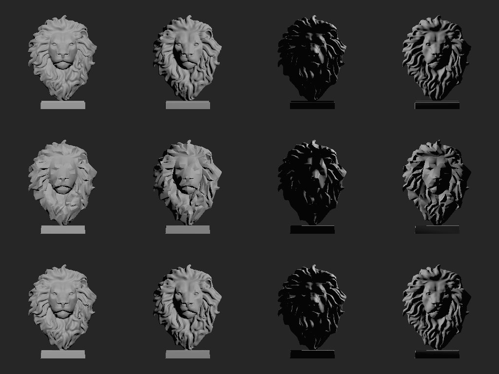

- **Bake Detail** sits next to Apply. Choose Off, **Normal Map** or **Normal + Color**, at 512 to 4096 pixels. Your mesh is only read. Normal + Color makes one new material with new UVs and is the recommended route for textured game assets.
- **Texture Sets** (next to Bake Size, with Normal + Color): bake onto 1 to 16 sets of maps, each its own material, so a big model keeps its detail. Whole parts go together, in sets of about equal area. Faces on a set's border are split, as on any UV seam.
- **Make LOD Set** makes three new objects named `_LOD0`, `_LOD1` and `_LOD2` for game engines, each a Reduce To of your mesh at percents you choose (50, 25 and 12.5% by default). Only the first runs the full search.
- **Keep UV Seams** keeps each quad inside one UV island. It is off by default, because a model cut into many islands can need up to about twice the faces.
- **Hard edges.** Apply marks edges sharper than 60 degrees as hard, and the result takes its shading from the nearest source points, so flat sides stay flat. Under Options, **Hard Edges** can instead be Leave, **Mark Sharp + Crease** (no extra faces, a Subdivision Surface keeps the edge) or **Holding Edges** (a loop on both sides of every hard edge, at a % of the next face or in millimetres).
- **Export for Game Engine** (File > Export > CurioMesh Game Asset, or the button after Apply) writes the selected meshes and their maps for the engine you pick. It keeps the bake's triangles, and your objects and images in Blender are not changed.

### Export targets

| Pick | Writes | Normal map | Limits | Tested here |
|---|---|---|---|---|
| Unreal | FBX + PNG | green flipped (DirectX) | | Unreal 5.7 |
| Unity | FBX turned and scaled for Unity + PNG | as baked (OpenGL) | | Unity 6 |
| Godot | .glb, textures inside | as baked | | Godot 4.7 |
| Roblox | FBX at FBX unit scale, with tangents + PNG | as baked | 20,000 triangles per mesh, 1024 textures | no, from Roblox's docs |
| Web and glTF (three.js, Babylon.js, Bevy, Sketchfab) | .glb | as baked (glTF is green up) | | no |
| CryEngine, O3DE | FBX + PNG | green flipped | | no |
| Custom | FBX, .glb or OBJ | your pick | your triangle limit and texture size | |

A mesh over the triangle limit is written as several pieces under it, cut along texture sets first and then along parts, so each piece uses one set of maps.

<details>
<summary>Engine test results, and export and bake caveats</summary>

**Tested in Unreal 5.7, Unity 6 and Godot 4.7** under a light circling the model from 8 sides. The test used a 47,214-face sculpt reduced to 1,068 faces with a 1024 bake, compared with the original by how far the shading differs (lower is closer):

| Engine, front view | No normal map | Exported normal map | Normal map in the wrong format |
|---|---|---|---|
| Godot 4.7 (.glb) | 0.83 | **0.37** | 1.01 |
| Unreal 5.7 (FBX + PNG) | 0.180 | **0.157** | 0.177 |
| Unity 6 (FBX + PNG) | 0.232 | **0.095** | 0.267 |

Imported with default settings, the exported files gave the closest result in all three engines.

- A plain FBX export sends no textures, because a bake lives only inside the .blend until saved, and a plain glTF export lets the engine choose its own triangles. Use Export for Game Engine, or save the images and tick Apply Modifiers.
- Baking blocks Blender until it finishes and reads the surface nearest to each texel, so parts that touch can bleed into each other. Only the normal map and base colour are baked, not roughness or metal.

</details>

### Multires Detail: a clean cage with your shape in the levels

Turn on **Multires Detail** (it is Animation's default route, and offered for Subdivision and Sculpt Base) and CurioMesh makes a clean, low quad cage.
On Apply, the cage keeps its faces at level 0 and gets a Multires modifier whose levels bring your mesh's shape back, using Blender's own Subdivide and
Reshape. Animate or export level 0, and sculpt or bake from the levels above it. Your mesh is only read. On the bust, the cage has 4,228 quads at level 0, 16,912 at level 1 and 67,648 at level 2.

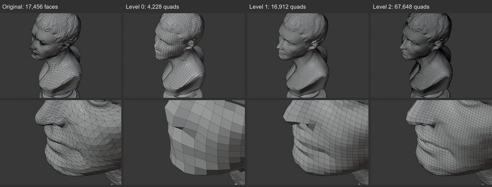

Level 0 keeps its own rough outline, so a normal map changes its shading only. For any cage you made yourself, select it and your source mesh and press
**Add Multires Detail**.

[Back to top](#curiomesh-free-auto-retopology-and-quad-remesh-add-on-for-blender)

## Hard Surface

Hard Surface is a Use for machine parts (under More Uses). It is Game Asset at Detail 5% with two rebuilds switched on, and every hard edge marked Sharp and Creased on Apply. It is an early feature.

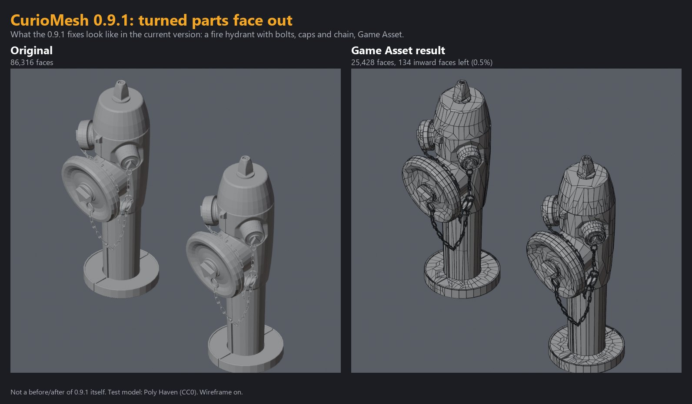

- **Clean Panels.** A part made of flat faces (box, plank, plate, bracket, bevel strip) is also offered laid out by panels: each convex flat area one grid along its own edges, a flat area round one hole a ring of quads round it, other flat areas cut and split so they stay all quads. Every panel border stays an exact edge loop and both sides of it agree, so it is watertight. A chamfer strip comes out as one row.
- **Even Cylinders.** A turned part is also read by the longest path through the tree of its rings, and a scanned tube is read wall by wall so its inside stays hollow. A visibly round part (radius at least 5% of the model) never drops below about 16 sides.
- **Round parts at least 16 sides** in every use: a turned part whose radius is a tenth of its size or more is no longer swept with 8 or 12 steps.
- **Hard Edges** on Apply (Options): Leave, Mark Sharp + Crease, or Holding Edges. See [Finish](#finish).

The camera keeps a layout only where the view holds. The two rebuilds are also switches in Options and are off in every other use, because the results are mixed.

<details>
<summary>Measured results (Game Asset, Keep Detail 6%, rebuilds off to on)</summary>

- Overhead crane: Issue Finder total 5,612 to 5,392, inward + folded + crossing 481 to 425, slivers on flat parts 1,084 to 1,014, Tidiness 40 to 42.
- Fire hydrant: inward + folded + crossing 234 to 145, but poles 872 to 1,430. On the hydrant, 16 turned parts that were 8 to 20% off now fit within about 1%.
- Old compressor: worse (inward + folded + crossing 208 to 287, slivers on flat parts 506 to 682). Treasure chest: a little worse.
- Drill press and barrier: unchanged, because the camera turned the rebuilds down.
- 0 to 25% more time. That is why the rebuilds are opt-in.

</details>

[Back to top](#curiomesh-free-auto-retopology-and-quad-remesh-add-on-for-blender)

## Shape the flow

Use the **Shape the flow...** popover when you want the quads to run a certain way: around an eye, across an elbow, mirrored, or denser where you say.

- **Draw Edge Loops.** Draw a closed loop around an eye or the mouth, or an open line. Each becomes a strip of regular quads with the
  poles pushed outside it. **Deformation Lines** across an elbow, knee or mouth corner become three or more evenly spaced loops. Move or redraw
  a curve and the result updates. In our test, a ring across a bent neck cut collapsed quads there from 6.2% to 4.0%. A broad bend saw no
  difference, so it helps tight joints and little else.
- **Guide Curves.** Draw strokes on the mesh, or add curves, Grease Pencil drawings or edge-only meshes. The quads follow them.
- **Detail Markers.** **Paint More** or **Paint Less** in Weight Paint, or add **marker balls** at the 3D cursor and scale them. The faces go where you said at every Quad Size: on the bust, a More ball on the mouth and a Less ball on the hair doubled the faces per area in the mouth against the hair. With Mirror, a marker on either side counts.
- **Mirror** (Auto, X, Y or Z). Solves one half and mirrors it, so both sides match and the seam is exact. Auto uses the plane only when 90% of the surface matches.
- **Symmetrize** (next to Mirror). Mirrors even when the sides differ, as on scans and sculpts: the result is built on one side (**Keep Side**) and mirrored, and **Set Plane** puts the plane where you type. The panel says how far apart the sides were ("the sides differ by up to 38.8 mm") and checks the seam: on a horse statue, 4 faces crossing the plane before, none after, and no open or doubled seam edges at any Quad Size.

Mirror, Guide Curves and Detail Markers work in Auto Segments only. Guide strokes on a Grease Pencil object need Blender 4.3 or later.

### Flow Editor (experimental, off by default)

Turn on **Flow Editor (Experimental)** in the add-on preferences and **Draw on the mesh** appears under Shape the flow. Draw on a finished result and the quads around the stroke are redone on their seams; the rest stays as it is.

- **Draw** recognises what you drew: a closed loop becomes a **Ring** (a clean closed edge loop with rows round it), a line along a sharp crease an **Edge**, any other line a **Flow** line the rows follow. Change it with one click (or F, R, E while drawing). On a test set of 57 drawn shapes it was right on all 57.
- **Flow**, **Ring** and **Edge** force a kind; **Place Circle** (drag to size, Shift for an ellipse); **Eye**, **Mouth** and **Nose-Mouth** place those shapes where you click; **Erase** and **Erase All**. Strokes are curves in the guide list, saved with the .blend and used by Start too; with a mirrored result they work on both sides.
- Not yet measured inside Blender. On the bust outside Blender, a ring round the forehead redid 268 faces into 417 in 1.6 s with five closed loops round it, and a flow line redid 79 faces in 0.5 s, both with clean seams.

[Back to top](#curiomesh-free-auto-retopology-and-quad-remesh-add-on-for-blender)

## Parts

A connected model is split into parts, and **Review Segments** lets you redo only the part that is wrong. Use it when most of the result looks right and one spot does not.

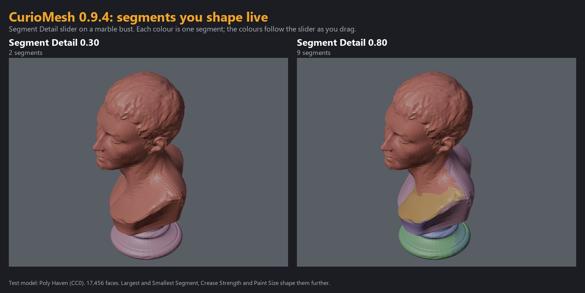

After a run, press **Review Segments**. The result is drawn with every part in its own colour. Hover a part to see its faces before
and after, how much of the view it changed, and its method. Click a part (Shift+click for several), pick a Use, Method or Detail for
it, and press Redo. Only that part is remade, while Blender stays usable. Its seam stays where it was, so it joins its neighbours with
no gap. **Next** and **Previous** jump to the parts that changed the most. Every try is kept, so you can go back to any earlier one at once.

Big loose pieces are also split along necks and creases, so a bust can become head, torso and plinth. How they split is up to you,
per mesh: **Segment Detail**, **Largest** and **Smallest Segment**, **Crease Strength** and **Border Smoothness** recolour the segments
live while you drag, and **Paint Size** lets you paint red where you want smaller segments and blue where you want larger ones. By hand
you can merge, split with a drawn line or in two along the segment's own border, grow or shrink a segment with a brush, paint a new one,
rename and lock them. Edited segments are locked, so later size changes keep them, and the next run uses them. Part kinds (tube, flat plate, rough scan) are a rough guess from the shape, and the guess can be wrong.
The [CHANGELOG](CHANGELOG.md) has the full list.

[Back to top](#curiomesh-free-auto-retopology-and-quad-remesh-add-on-for-blender)

## Blockout and Hulls

Two Uses for fast, faceted stand-ins: Blockout for solids that fit each part, Hulls for a quick low-poly look. Both are tiles in **What is it for?** (Hulls is under the small arrow).

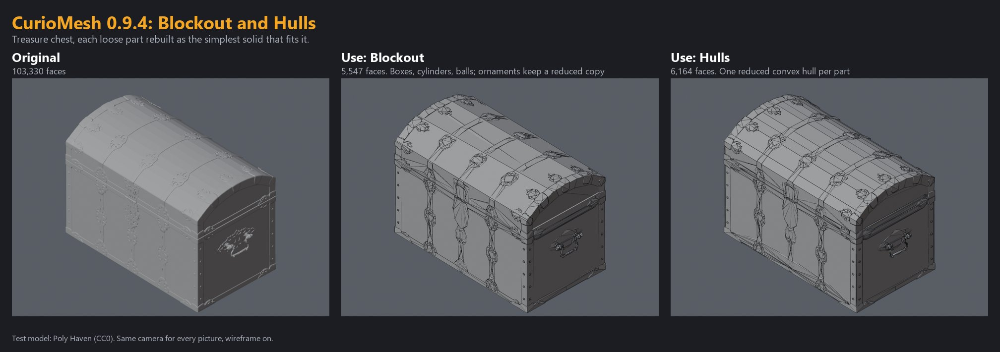

- **Blockout.** Every loose part of your mesh becomes the low-poly solid that fits it best: an oriented box, a cylinder (axis found from the part, capped with quads) or a ball (a quad sphere, stretched to an ellipsoid), or a small convex hull when that matches clearly better. The camera picks, from the part's own six views. A big part no single solid fits is cut at its creases by the segment finder and each segment gets its own solid. A part that still looks wrong keeps a reduced copy of itself, so nothing comes out crushed; the result says which parts did. All quads except the hulls. Each solid takes the material most of its part had.
- **Hulls.** Every part becomes its own reduced convex hull, for a quick faceted low-poly look. Concave parts are cut at their creases first.
- **Primitive Sides** sets the sides of each cylinder and the detail of each ball (small parts get half), and the size of the hulls. **Each Part Its Own Object** makes Apply write one object per loose part.
- Apply, Undo, Bake Detail and Make LOD Set work as with the other Uses; in a LOD set each level halves the sides.

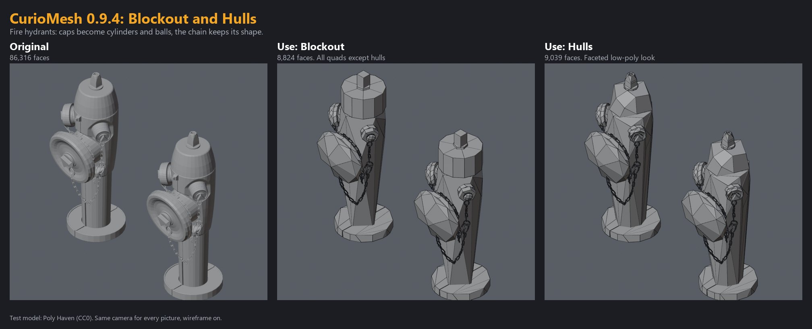

[Back to top](#curiomesh-free-auto-retopology-and-quad-remesh-add-on-for-blender)

## Pro tab and classic tools

The main panel keeps to one path. Everything else lives in the **CurioMesh Pro** tab (the **Pro** button in the panel header, or the preference). Use it when you want a setting the panel does not show.

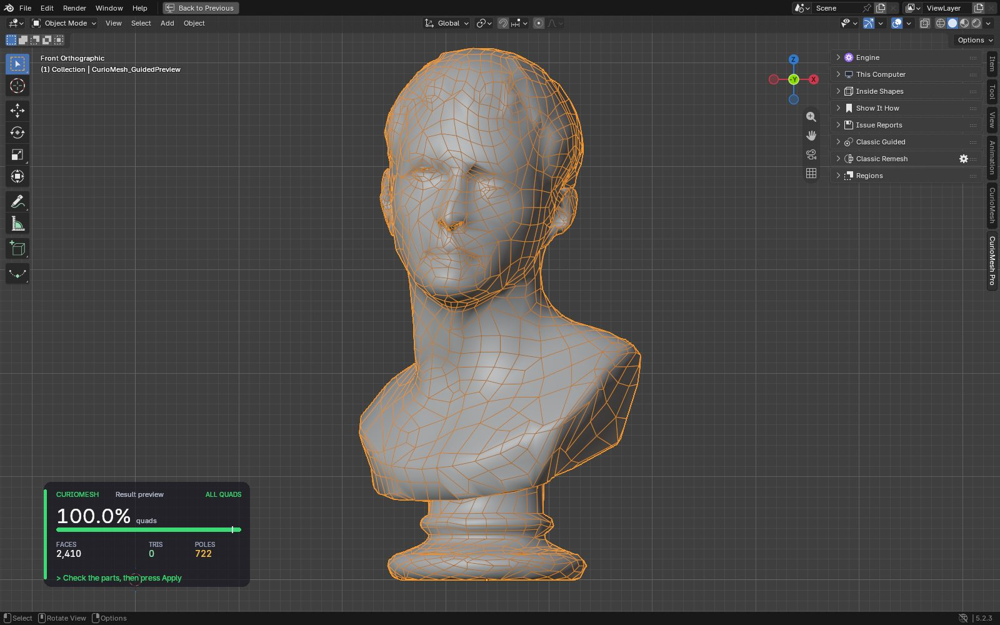

- **Engine:** Style, Method, Output, the cleanup switches, what is kept, Multires, Tweak.
- **Cleanup: Quick / Normal / Thorough** in the main panel replaces three tidy switches (Normal turns on Redo Rough Spots, Thorough also Redraw Messy Quads and Tidy Quads). The switches are still in the Pro tab one by one.
- **This Computer**, **Inside Shapes**, **Show It How** and **Issue Reports**.
- **Classic Guided** (Whole Mesh, Points Only, Work Areas), **Classic Remesh** and **Regions**. A file saved with a Classic Guided mode says so in the main panel, with a button to open it in Pro.
- Every operator name and saved setting is unchanged, so scripts, agent skills and older .blend files keep working.

Whole-mesh Atlas-Q, **Regions** (redo any selection or cage with an exact seam), **Flat Quads**, **Guided points** and **Work Live** are all still in
CurioMesh. They are described in [docs/OLDER_FEATURES.md](docs/OLDER_FEATURES.md). The solvers, controls and maths of the whole-mesh remesher
are in [docs/ATLAS_Q_REFERENCE.md](docs/ATLAS_Q_REFERENCE.md). Release notes are in [CHANGELOG.md](CHANGELOG.md).

<details>
<summary>The rest of the feature list</summary>

| Feature | What it does |
|---|---|
| **Redraw Messy Quads** | Parts with many irregular vertices are redrawn as pole-free grids. On for Animation and Subdivision, and left off on models of many loose parts. |
| **Segments inside one mesh** | Splits a connected model along necks and creases (head, torso, plinth). Merge, split, paint, rename. |
| **Draw Edge Loops and Deformation Lines** | Loops round eyes and mouths, lines across joints. The quads follow. |
| **Mirror, Symmetrize, Guide Curves, Detail Markers** | Symmetric results with a checked seam, strokes the quads follow, and more or fewer faces where you mark. |
| **Quad Size, Rows, Tidy Up, Bigger/Smaller Quads** | Live sliders for quad size, for fewest faces to even rows and for tidier layouts, and per-part size changes. |
| **Tweak** | Rows on Round Areas, Flat Area Size, Avoid Poles. |
| **Texture Sets, Export for Game Engine** | Bake big models onto several sets of maps; write FBX, .glb or OBJ for your engine with meshes split under its triangle limit. |
| **Show it how** | Fix a spot by hand once, and CurioMesh finds the same pattern in later results. |
| **Redo inside shapes (Live Boolean)** | Union, Subtract or Intersect boxes and spheres, and only what is inside is redone, live. |
| **UV and shading care** | Keep UV Seams, hard edges past 60 degrees, shading read from your source. |
| **Checks and repair** | Non-manifold edges, flipped faces, duplicates, holes, crossing faces. What cannot be fixed is selected. |
| **Tidiness score** | A 0 to 100 number for how close the quad layout is to hand-made meshes. |
| **Part cases** | Each part is named (tube, flat plate, rough scan and so on) so the search starts at sensible sizes. |
| **Rough As Texture, Leave Out Hidden Pieces** | Off by default. Far fewer faces on rough scans. Drops loose pieces no camera can see. |
| **Keep Copies as Instances** | Repeated parts become linked objects, so a copy costs no geometry. |
| **Effort levels, This computer, Export Job** | Work in small steps, or run the job on a stronger computer and import the result. |
| **Regions** | Redo any selection, face set, vertex group or cage with an exact seam. [More.](docs/OLDER_FEATURES.md) |
| **Flat Quads** | Flat areas become one big quad each. [More.](docs/OLDER_FEATURES.md) |
| **Guided points and Work Live** | Click where detail matters, and retopo area by area in the background. [More.](docs/OLDER_FEATURES.md) |
| **Classic Remesh** | The older whole-mesh remesher (Atlas-Q, Fill Loop, Fit to Surface), folded away under the Guided panel. [More.](docs/ATLAS_Q_REFERENCE.md) |
| **HUD and heatmap** | Quad percentage, leftover triangles and poles, shown in the viewport. |
| **Native core** | Rust code on all cores for the slow steps, with a Python fallback. |

</details>

[Back to top](#curiomesh-free-auto-retopology-and-quad-remesh-add-on-for-blender)

## How it checks results

Every result is compared with your original by a camera check, so you do not have to judge it by eye alone.

- CurioMesh renders the original and the result from six sides and measures **View changed**: the share of the picture that differs. It measures this itself.
- View changed is not a quality score, and it says nothing about how tidy the quads are. Read it next to **Tidiness** (0 to 100, how close the layout is to hand-made meshes) and **Loop Quality**.
- **Size** is the result as a share of the original's faces.
- The camera also picks between layouts per part, keeps a layout only where the view holds, and undoes a repair it dislikes.
- Detail is how much of the view may look different from your mesh. The default Game Asset setting is Keep Detail at Detail 6%.

[Back to top](#curiomesh-free-auto-retopology-and-quad-remesh-add-on-for-blender)

## Results

Every example ran the real add-on on a free [Poly Haven](https://polyhaven.com) model (CC0) with the default Game
Asset settings: Keep Detail, **Detail 6%**. You can download the same models and check the numbers. Each picture shows the original (left) and the result (right), the whole
object on top and a close-up below.

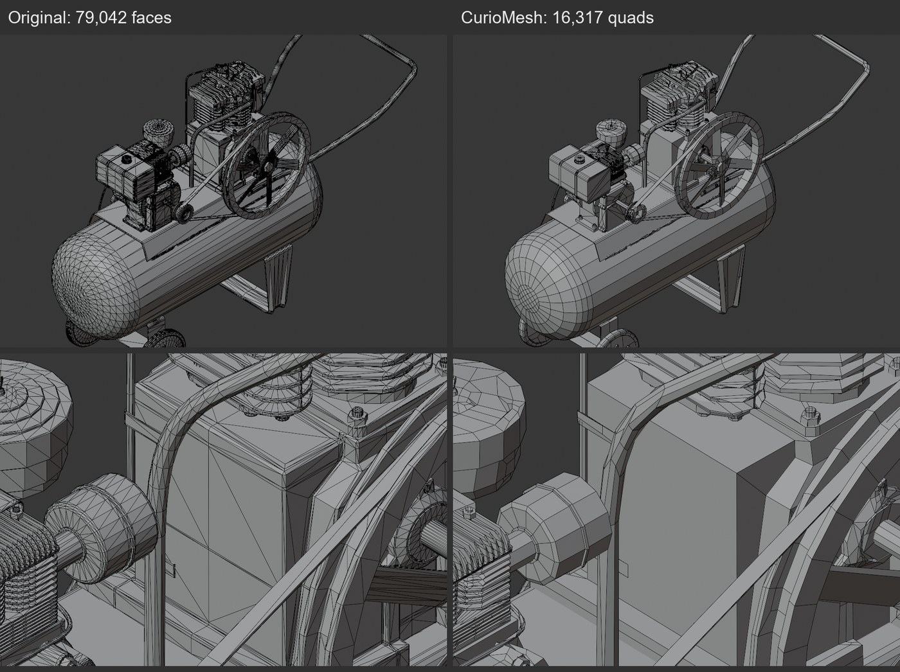

*[Old military compressor](https://polyhaven.com/a/old_military_compressor) (free CC0 model), Keep Detail, fewest faces: 79,042 faces to 15,881 quads, 5.6% of the view changed. Wire shown on both sides.*

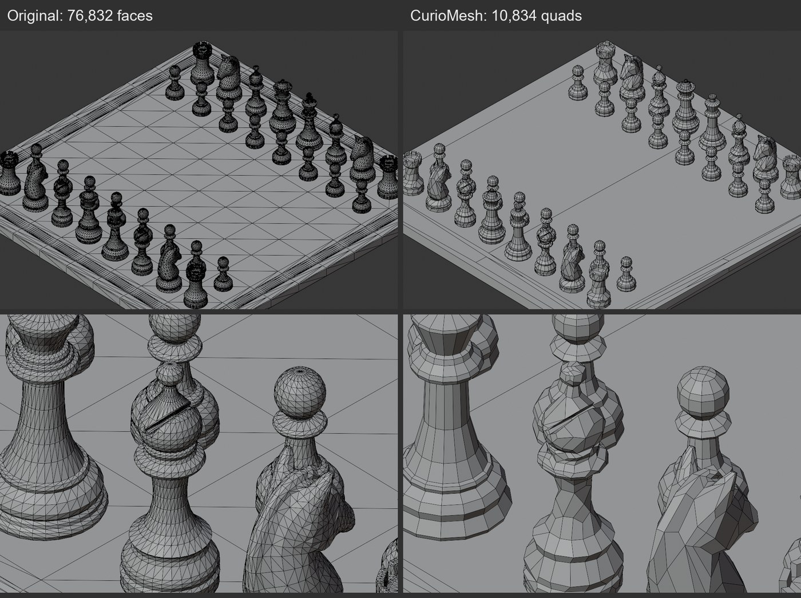

*Chess set (33 pieces), [Poly Haven](https://polyhaven.com/a/chess_set), CC0.*

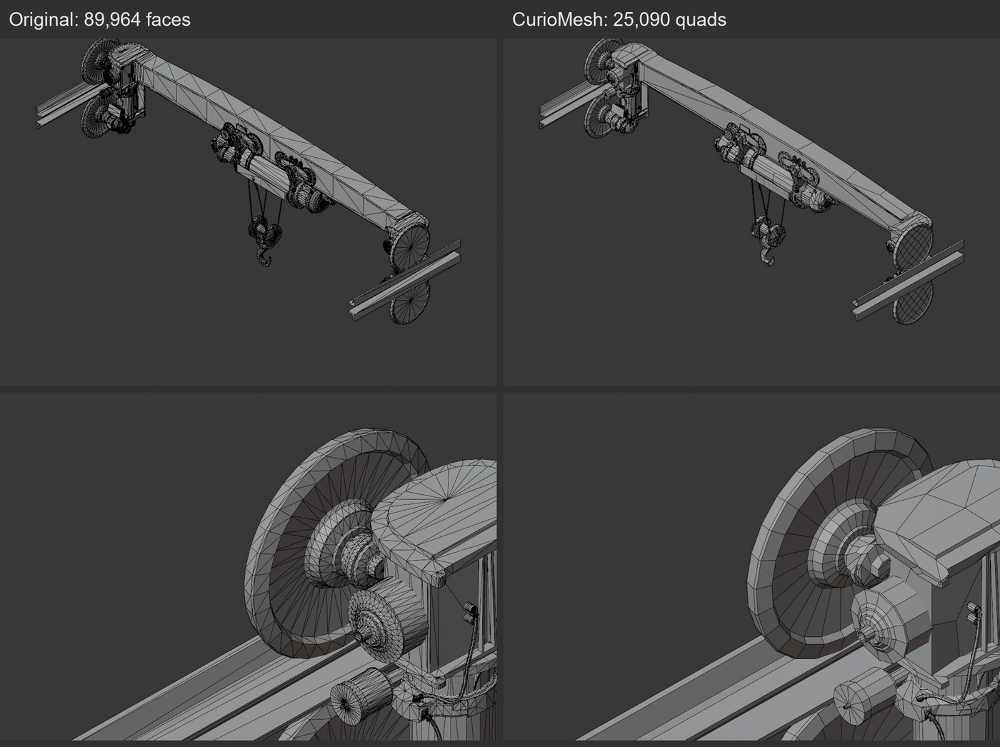

*Overhead crane, [Poly Haven](https://polyhaven.com/a/overhead_crane), CC0.*

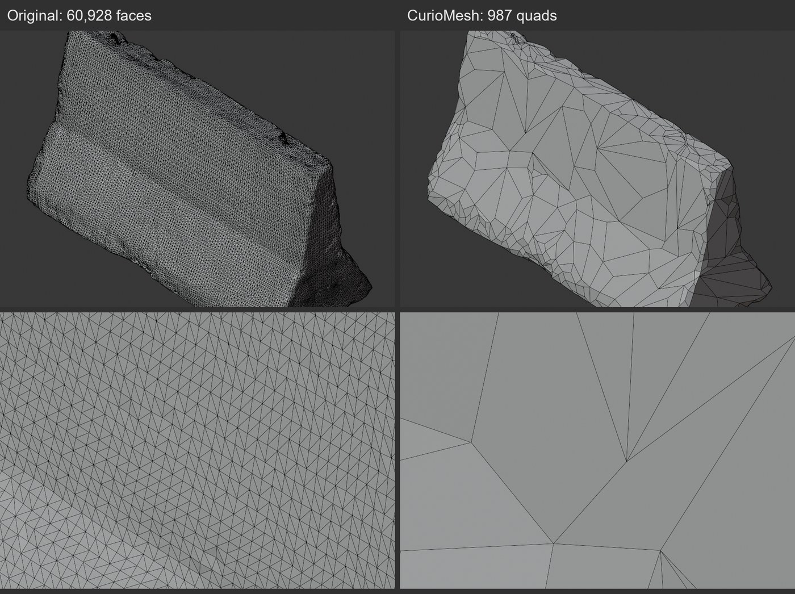

*Concrete road barrier, [Poly Haven](https://polyhaven.com/a/concrete_road_barrier), CC0. Keep Detail quads follow the shape, so on smooth surfaces they can look slanted.*

Rough rock and fine detail need the most faces to keep their look. Hard-surface models with big smooth areas gain the most.
The sofa starts small, at 4,101 faces, and still ends at 1,571.

<details>
<summary>All 20 models: faces, size and view changed</summary>

| Model | Original faces | CurioMesh quads | Size | View changed | Wire pictures |
|---|---:|---:|---:|---:|---|
| [Marble bust](https://polyhaven.com/a/marble_bust_01) | 17,456 | 2,508 | 14% | 6.0% | [before and after](docs/images/marble_bust_01.jpg) |
| [Concrete road barrier](https://polyhaven.com/a/concrete_road_barrier) | 60,928 | 987 | 2% | 5.9% | [before and after](docs/images/concrete_road_barrier.jpg) |
| [Old military compressor](https://polyhaven.com/a/old_military_compressor) | 79,042 | 15,881 | 20% | 5.6% | [before and after](docs/images/old_military_compressor.jpg) |
| [Fire hydrant](https://polyhaven.com/a/fire_hydrant) | 86,316 | 26,771 | 31% | 4.9% | [before and after](docs/images/fire_hydrant.jpg) |
| [Treasure chest](https://polyhaven.com/a/treasure_chest) | 103,330 | 10,423 | 10% | 4.8% | [before and after](docs/images/treasure_chest.jpg) |
| [Gothic statue](https://polyhaven.com/a/gothic_statue) | 27,739 | 16,586 | 60% | 5.9% | [before and after](docs/images/gothic_statue.jpg) |
| [Lion head](https://polyhaven.com/a/lion_head) | 47,214 | 7,940 | 17% | 5.9% | [before and after](docs/images/lion_head.jpg) |
| [Horse statue](https://polyhaven.com/a/horse_statue_01) | 22,388 | 5,609 | 25% | 5.9% | [before and after](docs/images/horse_statue_01.jpg) |
| [Chess set (33 pieces)](https://polyhaven.com/a/chess_set) | 76,832 | 10,110 | 13% | 3.6% | [before and after](docs/images/chess_set.jpg) |
| [Spinning wheel](https://polyhaven.com/a/spinning_wheel_01) | 52,023 | 16,644 | 32% | 3.7% | [before and after](docs/images/spinning_wheel_01.jpg) |
| [Sofa (already low poly)](https://polyhaven.com/a/Sofa_01) | 4,101 | 1,571 | 38% | 5.9% | [before and after](docs/images/Sofa_01.jpg) |
| [Drill press](https://polyhaven.com/a/drill_press_01) | 58,511 | 16,809 | 29% | 5.8% | [before and after](docs/images/drill_press_01.jpg) |
| [Overhead crane](https://polyhaven.com/a/overhead_crane) | 89,964 | 22,541 | 25% | 5.4% | [before and after](docs/images/overhead_crane.jpg) |
| [Modular wooden pier](https://polyhaven.com/a/modular_wooden_pier) | 84,780 | 25,906 | 31% | 6.0% | [before and after](docs/images/modular_wooden_pier.jpg) |
| [Moss rocks (6 pieces)](https://polyhaven.com/a/rock_moss_set_01) | 63,127 | 20,425 | 32% | 5.9% | [before and after](docs/images/rock_moss_set_01.jpg) |
| [Namaqualand boulder](https://polyhaven.com/a/namaqualand_boulder_02) | 97,964 | 52,789 | 54% | 6.0% | [before and after](docs/images/namaqualand_boulder_02.jpg) |
| [Ship pinnace](https://polyhaven.com/a/ship_pinnace) | 168,317 | 59,904 | 36% | 5.8% | [before and after](docs/images/ship_pinnace.jpg) |
| [Dutch ship](https://polyhaven.com/a/dutch_ship_large_01) | 110,616 | 36,115 | 33% | 6.4% | [before and after](docs/images/dutch_ship_large_01.jpg) |
| [Coast rocks (scan)](https://polyhaven.com/a/coast_rocks_02) | 1,260,423 | 434,995 | 35% | 5.9% | [before and after](docs/images/coast_rocks_02.jpg) |
| [Coastal cliff (scan)](https://polyhaven.com/a/coastal_cliff_04) | 1,537,926 | 362,292 | 24% | 6.0% | [before and after](docs/images/coastal_cliff_04.jpg) |

The numbers are from commit `7f94ff8`, run on Blender 5.2.3 LTS. The Issue Finder (0.9.3 and later) counts bad faces (turned inward, folded over or crossing); they are shown in red and can be fixed with Fix Selection or Keep Original Where Bad.

</details>

[Back to top](#curiomesh-free-auto-retopology-and-quad-remesh-add-on-for-blender)

## Big scans and small PCs

CurioMesh tells you what a job will cost before you start it, and can hand a big job to a stronger computer. Use it for scans of hundreds of thousands of faces or more, or on a modest PC.

- The **This computer** box reads your cores, free memory and graphics card and says in words how big the job is for this PC, and says so plainly when the PC is on the small side.
- Before Start, the panel gives the time on this PC, including any bake ("about 3 to 12 minutes, plus about 70 seconds of baking that blocks Blender"). Heavy options carry a **Slow** or **Heavy** tag with the time they add.
- Before a long job, Start, Make LOD Set and Apply ask first and list cheaper ways (Effort Light, Keep Detail, a smaller bake, Export Job).
- **Effort** (Auto, Light, Normal, Full) trades speed for a usable Blender. Pieces too big for the effort are cut into regions with their borders kept
exactly. Each region appears when it is done, and finished regions are saved so a stopped job resumes.
- **Export Job** writes a folder you can run on any computer that has Blender (`blender --background --python run_job.py`).
**Import Result** brings the answer back. CurioMesh never uploads anything and has no accounts or keys. See [docs/CLOUD_WORKFLOW.md](docs/CLOUD_WORKFLOW.md).
- **Rough As Texture** judges rough surfaces by their average direction instead of every pixel, so far fewer faces are kept (bumps smaller than a few pixels are lost). **Leave Out Hidden Pieces** drops loose pieces that no outside camera can see. Both help on rough scans of rock, terrain or sea floor, and both are off by default.

At the default settings, the coast rocks scan went from 1,260,423 faces to 434,995 quads (5.9% of the view changed) in 5 min and the coastal cliff scan went from 1,537,926 faces to 362,292 quads (6.0% of the view changed) in 7 min, on a PC that was also doing other work. Both stayed all quads.

[Back to top](#curiomesh-free-auto-retopology-and-quad-remesh-add-on-for-blender)

## Without Blender

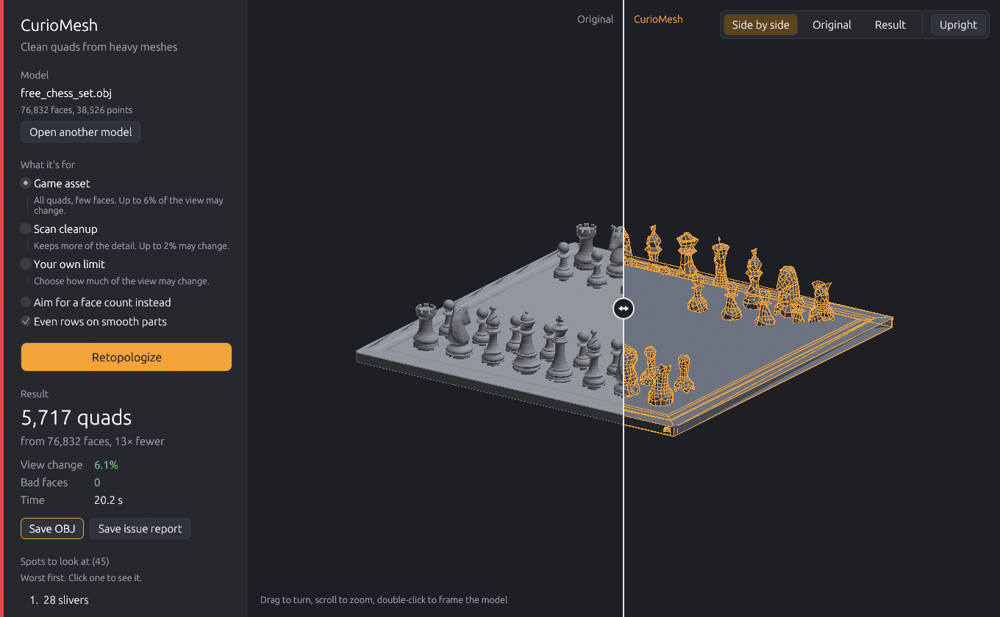

CurioMesh also runs as a desktop app for Windows, macOS and Linux, with no Blender needed. Say what the model is for,
open it or a whole folder, and drag the line across the model to compare the original with the new quads. Each
result gets the same verdict as the panel here ("Good for game asset", "Check 2 spots").

- **Download:** the zip for your system from the [standalone releases](https://github.com/CurioCrafter/CurioMesh/releases?q=standalone).
  Unpack it and start `curiomesh-gui`.
- **Batch:** a folder at a time, with a results table you can export as CSV.
- **Opens** OBJ, glTF, GLB and PLY. **Saves** OBJ, or GLB for Unreal, Unity, Godot, Roblox and glTF.
- **Command line for pipelines:** `curiomesh batch models/ -o done/`, and `curiomesh measure model.glb any_retopo.obj
  --max-loss 6 --max-bad 0` to stop a build on a broken asset from any tool.
- **Same core** as the add-on: its Rust reducer, quad pairing and closing, and its six-view camera.

On three free test models at about the same face count, it kept far more of the shape than AutoRemesher 1.2.0
(drill press: 8.2% of the view changed against 32.8%, 0 bad faces against 1,219). AutoRemesher's quads are more even
on smooth, organic shapes. The guide is [standalone/README.md](standalone/README.md); the plan and the legal notes are
in [standalone/PLAN.md](standalone/PLAN.md).

[Back to top](#curiomesh-free-auto-retopology-and-quad-remesh-add-on-for-blender)

## Agent skills

The `skills/` folder holds skills (the open Agent Skills format: one folder with a `SKILL.md`) that teach an AI agent to run CurioMesh on its own, with no
Blender window, and to fix what comes out. The agent reads the skill, runs Blender in the background, reads a JSON report (faces, quads, how much the view
changed, bad faces per part) and retries with other settings.

| Skill | What the agent can do with it |
| --- | --- |
| `curiomesh-retopo` | Turn a file (.obj .fbx .glb .blend) into a clean quad mesh, pick the Use and Detail, check the report, retry. |
| `curiomesh-fix-bad-faces` | Find inward, folded, crossing and flat faces, fix them (Clean Up, Flip Inward, Untangle, Relax, Patch), measure again, and never keep a change that makes it worse. |
| `curiomesh-batch-and-lods` | Many files in a row, `_LOD0` to `_LOD2` sets, normal-map baking. |
| `curiomesh-blender-mcp` | Drive CurioMesh in a Blender that is already open, through the Blender MCP server. |

Install, in Claude Code:

```
/plugin marketplace add CurioCrafter/CurioMesh
/plugin install curiomesh-skills@curiomesh
```

Any other agent (or Claude Code without plugins): download `curiomesh-<version>-agent-skills.zip` from the [latest release](https://github.com/CurioCrafter/CurioMesh/releases/latest)
and unzip it into your skills folder, or copy all four `skills/curiomesh-*` folders there yourself (`~/.claude/skills/` for Claude Code). The skills share one set of
scripts, so keep the four folders together. You still need CurioMesh installed in Blender ([Install](#install)), and Blender 3.6 to 5.2.

Then ask, for example: *"Retopologise `crate.fbx` for a game with CurioMesh, about 3,000 faces, and fix any bad faces."*

The scripts also work by hand: `blender -b --factory-startup --python skills/curiomesh-retopo/scripts/curiomesh_run.py -- model.obj --use GAME --detail 6 --out model_low.glb --report report.json`.

[Back to top](#curiomesh-free-auto-retopology-and-quad-remesh-add-on-for-blender)

## FAQ

<details>
<summary><b>Is there a free automatic retopology add-on for Blender?</b></summary>

Yes. CurioMesh is free and open source (GPL-3.0-or-later), works in Blender 3.6 to 5.2, and needs no account. Paid retopology tools exist too. This README makes no quality comparison with them.

</details>

<details>
<summary><b>How do I retopologize a scan in Blender?</b></summary>

Install CurioMesh, select the scan, open the CurioMesh tab, choose Auto Segments, pick the Scan Cleanup Use, and press Start. Check the result in Review Segments, redo any part that looks wrong, then press Apply. For scans over a million faces, set Effort to Light or use Export Job.

</details>

<details>
<summary><b>How do I make a low poly game asset from a high poly mesh?</b></summary>

Pick the Game Asset or Low Poly Use and press Start. Turn on Bake Detail with Normal + Color to carry the surface detail over as a normal map. After Apply, press Export for Game Engine and pick Unreal, Unity or Godot: it writes the mesh and its maps in the form that engine reads.

</details>

<details>
<summary><b>Can I get all quads from an automatic quad remesh?</b></summary>

Yes. Output defaults to Quads, and the summary reports leftover triangles, which are normally zero. Quads can still be slanted on smooth surfaces with Keep Detail. Balanced and Clean Rows give tidier layouts for more faces.

</details>

<details>
<summary><b>Can I redo just one part of a retopology?</b></summary>

Yes. Review Segments redoes one part with its own method and detail while the seam to its neighbours stays closed. Redo Inside Shapes does the same for any area you cover with a box or sphere.

</details>

<details>
<summary><b>How is it different from Blender's Quad Remesh?</b></summary>

Blender's Quad Remesh works on the whole object in one pass. CurioMesh works part by part, measures each result against your original, and lets you redo single parts. QuadriFlow is also one of its Methods, for smooth organic parts.

</details>

<details>
<summary><b>How do I make LODs for a game asset in Blender?</b></summary>

Select the mesh, set the three percents in Make LOD Set (50, 25 and 12.5% by default) and press it. You get `_LOD0`, `_LOD1` and `_LOD2` as new objects, and only the first runs the full search.

</details>

<details>
<summary><b>Can I get a clean low-poly cage with the detail in Multires levels?</b></summary>

Yes. Multires Detail makes the cage and puts your mesh's shape in the levels above level 0. It is the default route for the Animation Use.

</details>

<details>
<summary><b>Does it keep my UVs?</b></summary>

Turn on Keep UV Seams and each quad stays inside one UV island, at the cost of more faces on models with many islands. Or bake with Normal + Color, which makes new UVs and does not need the old seams.

</details>

<details>
<summary><b>Does it upload my model?</b></summary>

No. Everything runs on your PC. Export Job writes a folder that you move yourself.

</details>

<details>
<summary><b>Does it work in Blender 4.x and 5.x?</b></summary>

Yes, from Blender 3.6 LTS up to 5.2. See [Install](#install) for which versions were tested for this release.

</details>

[Back to top](#curiomesh-free-auto-retopology-and-quad-remesh-add-on-for-blender)

## Known limits

- **Keep Detail quads are not always tidy.** It spends everything Detail allows, so on smooth surfaces quads can look slanted or scattered instead of running in rows. Spinning edges at poles helps (Tidiness about 28 to 39 on smooth busts), but it is still far from hand-made. Use Balanced or Clean Rows for that, at the cost of more faces. Clean Rows also loses small sharp detail.
- **Soft faces and fine detail go first.** At 6%, cloth folds, small rounded ends and fine ornaments are simplified. Lower Detail to keep more. CurioMesh does not give you a hand-made low poly yet.
- **UV seams.** By default quads may span several UV islands, so textures can smear there. Turn on Keep UV Seams (up to about twice the faces) or bake with Normal + Color.
- **Big scans are slow.** A scan of over a million faces can take a long time on a busy PC, and Blender can pause for a few seconds at a time. Use Effort, or Export Job.
- **No global patch layout.** CurioMesh has none, and it does not promise exact loops round eyes, mouths or joints without your help. An optional script, `scripts/flowtool.py`, can use QuadWild if you install it separately. It is not in the panel, it covers organic parts only, and it is untested on Linux and macOS.

<details>
<summary>More limits (methods, repair, sliders, builds, GPU)</summary>

- **Grid Fill and Flow Fill** only work on a part that is one open surface with one edge loop round it. Otherwise Auto is used, and the summary says so.
- **Repair is cautious.** A fix the camera dislikes, or one that adds over 3% more faces, is undone, and clearing crossings stops after 30 seconds, so a few spots can stay. They are selected on the applied mesh and named in the summary.
- **Selected Faces Only** for Draw Edge Loops does not close its seam yet and is switched off. Use Redo Inside Shapes.
- **Live Boolean** refuses a redo that would make more faces than it replaces. On a mesh already reduced hard, that can be most redos.
- **Native core builds.** The release workflow builds the native core for Windows, Linux and macOS (Intel and Apple Silicon). The Intel Mac build is compiled but not run in CI, and the developers tried only Windows by hand. Without the core, CurioMesh falls back to Python code, which is much slower on big meshes.
- **Little GPU compute.** Only the camera pictures of meshes over 150,000 triangles run on the graphics card (NVIDIA, AMD, Intel or Apple, no CUDA). That is 1.1 to 3 times faster for that step, about 1 to 2% for a whole run. Everything else runs on the processor, and a graphics card does not speed it up.
- **Folded slivers on some small thin parts.** A quad can come out bent about 90 degrees round an edge of a thin part. They are named in the summary and selected on Apply, so you can fix them by hand.
- **Judge After Baking is experimental.** On big flat areas of a scan it can leave long thin slivers, which bake badly, and its score misses them. It is off by default.
- **Redraw Messy Quads costs time.** On some models it roughly doubles the tidiness score for 7 to 50% more faces and 2 to 5 times the time, and it is left off on models of more than 40 loose pieces.
- **Sliders and markers.** Bigger Quads on one area of a one-piece mesh can be refused when it would lose the shape. Less Detail markers are weaker than More Detail at high face counts. Changing Symmetrize or Tweak after a run stops the background sizes until the next Start.
- Mirror, Guide Curves and Detail Markers work in Auto Segments only. Guide strokes on a Grease Pencil object need Blender 4.3 or later.

</details>

[Back to top](#curiomesh-free-auto-retopology-and-quad-remesh-add-on-for-blender)

## Contributing

- **Questions and help:** [Q&A](https://github.com/CurioCrafter/CurioMesh/discussions/categories/q-a)
- **Show your retopology:** [Show and tell](https://github.com/CurioCrafter/CurioMesh/discussions/categories/show-and-tell). Before and after screenshots and the settings you used help everyone.
- **Ideas and feature requests:** [Ideas](https://github.com/CurioCrafter/CurioMesh/discussions/categories/ideas)
- **Bugs:** [open an issue](https://github.com/CurioCrafter/CurioMesh/issues/new) with your Blender version, your CurioMesh settings and, if you can share it, the mesh or a small `.blend`.

Pull requests are welcome. Run the tests first:

```powershell
python -m unittest discover -s tests -v
ruff check .
python scripts\build_release.py
```

`python scripts\test_blender_matrix.py` runs the smoke and install tests on every Blender build it finds.

If CurioMesh saved you time, a [star on GitHub](https://github.com/CurioCrafter/CurioMesh/stargazers) helps other Blender artists find a free retopology tool.

[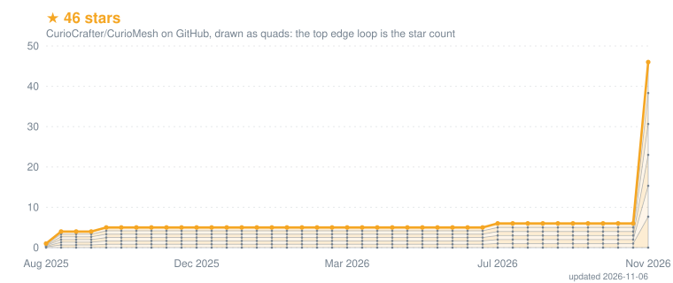](https://github.com/CurioCrafter/CurioMesh/stargazers)

[Back to top](#curiomesh-free-auto-retopology-and-quad-remesh-add-on-for-blender)

## Credits

- Test models are free CC0 models from [Poly Haven](https://polyhaven.com); thank you to Poly Haven for making them free for everyone. Models by: Marble bust: Rico Cilliers; Concrete road barrier: Amal Kumar; Old military compressor: Brian Speight; Fire hydrant: Goncalo Felicio; Treasure chest: Rico Cilliers; Gothic statue: Benny Weimer; Lion head: Tina; Horse statue: Rico Cilliers; Chess set: Riley Queen; Spinning wheel: Sofia Pahaoja; Sofa: Kirill Sannikov; Drill press: Viktor; Overhead crane: Timothy3D; Modular wooden pier: Rico Cilliers; Moss rocks: Kless Gyzen; Namaqualand boulder: Greg Zaal, Rico Cilliers; Ship pinnace: James Ray Cock, Rico Cilliers, Nicolo Zubbini, Yann Kervran; Dutch ship: James Ray Cock, Rico Cilliers, Nicolo Zubbini; Coast rocks: Rob Tuytel, Rico Cilliers; Coastal cliff: Rob Tuytel, Rico Cilliers.
- Idea from [cav3dw3ll3r](https://github.com/cav3dw3ll3r): fitting each source point to its nearest vertex, shading read from the nearest source points, and the finite test cases.
- The tidiness score is based on statistics measured from hand-made meshes. It holds no geometry. Sources and licenses are in
  [docs/PATTERN_SOURCES.md](docs/PATTERN_SOURCES.md).
- Credits for the CC-BY works, changed by reducing them to statistics ([CC-BY 4.0](https://creativecommons.org/licenses/by/4.0/)):
  - [Sprite Rig](https://studio.blender.org/characters/sprite/v1/) (CC-BY) Blender Foundation, studio.blender.org
  - [Rain Rig](https://studio.blender.org/characters/rain/v3/) (CC) Blender Foundation, studio.blender.org
  - [Pack Bot Rig](https://studio.blender.org/characters/pack-bot/v1/) (CC-BY) Blender Foundation, studio.blender.org
  - [Security Bot Rig](https://studio.blender.org/characters/security-bot/v1/) (CC-BY) Blender Foundation, studio.blender.org
- The triangle intersection test in the native core is ported from Blender's `isect_tri_tri_v3_ex` (GPL-2.0-or-later, Blender authors). Rust crates in the native core and their licenses are listed in [THIRD_PARTY_NOTICES.md](THIRD_PARTY_NOTICES.md).
- The whole-mesh solvers are CurioMesh's own implementations of published papers, listed in [docs/ATLAS_Q_REFERENCE.md](docs/ATLAS_Q_REFERENCE.md). No QuadWild source is copied or included.

## License

CurioMesh is free software: you can redistribute it and/or modify it under the terms of the GNU General Public License as published by
the Free Software Foundation, either version 3 of the License, or (at your option) any later version. See [LICENSE](LICENSE).

Versions up to 0.5.1 were released under MIT. From 0.6.0 on, CurioMesh is GPL-3.0-or-later, the same family of licence Blender itself uses.
