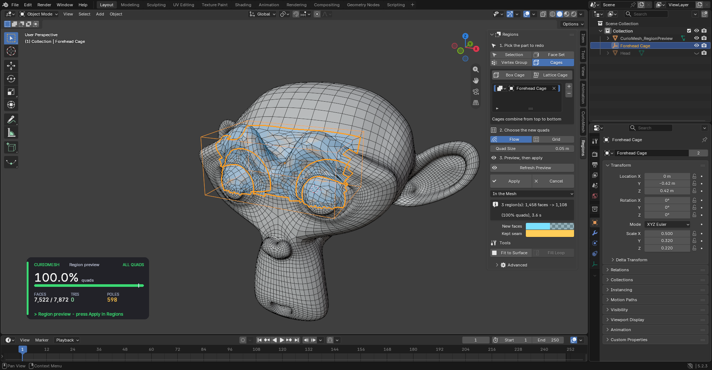
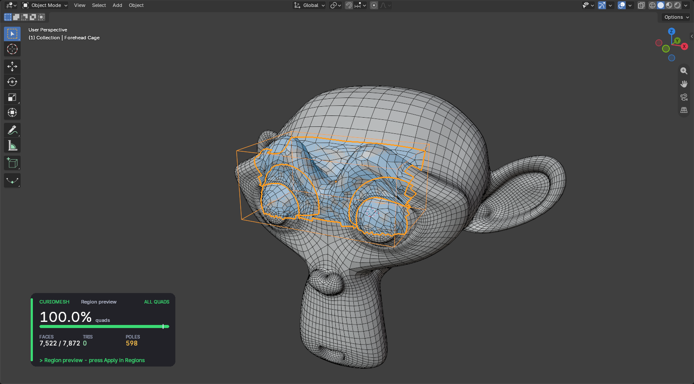
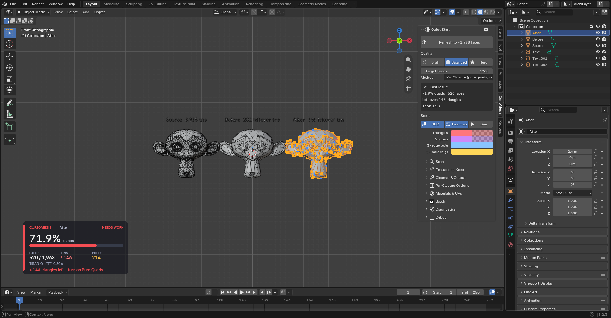
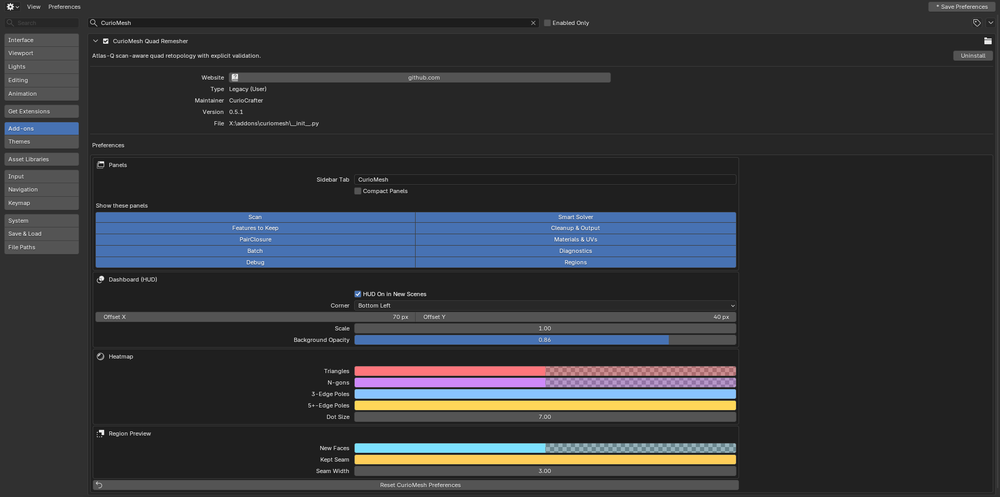
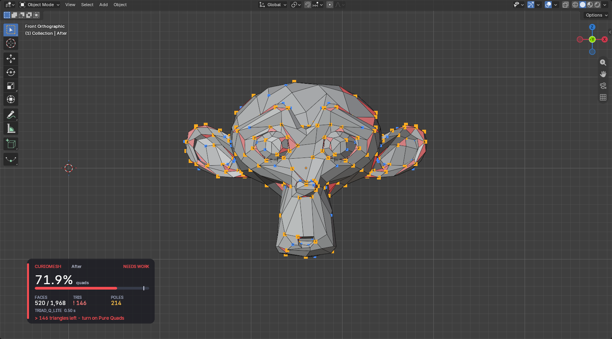
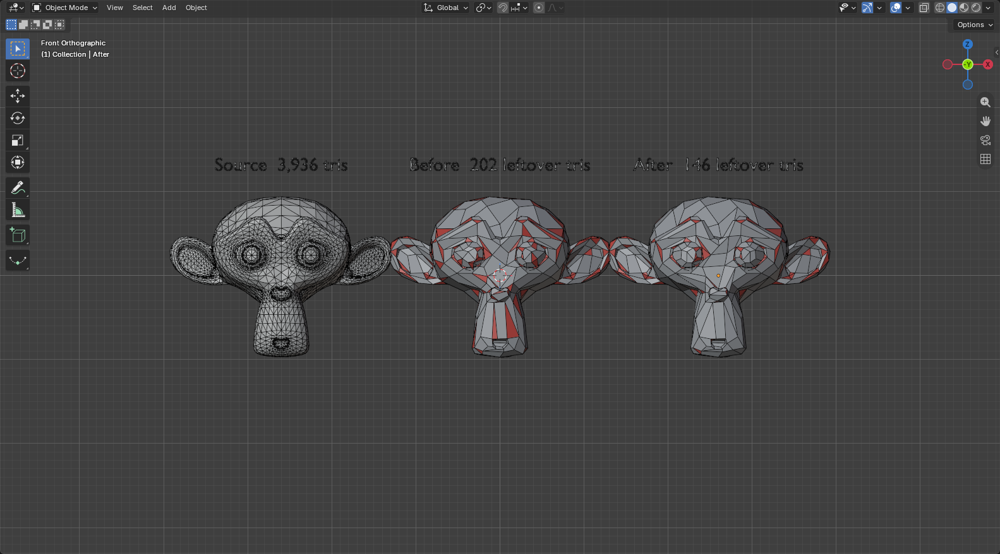

# CurioMesh: Free Quad Retopology for Blender, for the Whole Mesh or Just One Part

[](https://github.com/CurioCrafter/CurioMesh/releases/latest)
[](https://www.blender.org/download/)
[](LICENSE)
[](https://github.com/CurioCrafter/CurioMesh/stargazers)
[](https://github.com/CurioCrafter/CurioMesh/discussions)

**Turn sculpts, scans and messy game assets into clean quads inside Blender,
then redo only the part that still looks wrong.** Drop a box or lattice cage
over a face, a hand or a damaged panel, preview the new quads, and apply. The
rest of the mesh stays exactly as it was, and the new patch joins it with no
gaps. Free, open source, and tested on every Blender release from 3.6 to 5.2.



**[Download for your Blender version](https://github.com/CurioCrafter/CurioMesh/releases/latest)** ·
**[Ask a question or show your results](https://github.com/CurioCrafter/CurioMesh/discussions)** ·
A star helps other Blender artists find CurioMesh.

## What You Can Do With It

**Remesh a whole object in one click.** Pick Draft, Balanced or Hero, set a
face count and press the button. CurioMesh tries several solvers, measures each
result against your original, and keeps the best one that passes its quad and
topology checks. UVs and materials carry over.

**Redo just the part you choose.** Select faces, use a face set or vertex
group, or place cages. Stack cages as Union, Subtract or Intersect to carve out
exactly the area you mean, then press Preview. Faces outside the region are not
touched, and the seam keeps its original vertices, so there are no T-junctions
or holes to fix by hand.

**See problems before you export.** A dashboard in the viewport shows your quad
percentage, leftover triangles and poles, and tells you the next step. One click
paints leftover triangles, n-gons and poles right on the mesh.

## New in 0.6

| | 0.5 | 0.6 |
|---|---|---|
| What gets remeshed | The whole object | The whole object, or any region you pick |
| Picking a region | n/a | Edit-mode selection, face set, vertex group, box cage, lattice cage, any closed mesh as a volume |
| Combining regions | n/a | Union, Subtract and Intersect, applied top to bottom |
| Joining the patch back | n/a | Seam vertices are kept exactly; the patch is all quads inside |
| Fixing holes | By hand | **Fill Loop** fills a closed hole with quads that follow the surrounding curve |
| Snapping to the original | Shrinkwrap at the end of a run | **Fit to Surface**: relax and snap any mesh or selection back onto the source |
| Panels | One long Quick Start list | Numbered steps, one main button per panel, a Last Result box, plain-language tooltips on every option |
| Look and layout | Fixed | Preferences for tab name, compact mode, hidden panels, HUD corner/size/opacity and every overlay colour |
| Speed | Python and NumPy | **Turbo core in Rust** on all CPU cores: topology checks and quad closing about 30x faster, a 50k-face all-quad remesh 4.5x faster |
| Downloads | Two zips | A zip for each Blender version from 3.6 to 5.2, plus two all-in-one zips |

### Region retopology



Open the **Regions** panel in the CurioMesh tab and work through its three
steps:

1. **Pick the part to redo.** Selection, Face Set, Vertex Group or Cages. Add a
   Box Cage or a Lattice Cage and move, scale or bend it like any object. A
   lattice can follow a curved limb. Any closed mesh also works as a volume.
2. **Choose the new quads.** *Flow* follows the shape. *Grid* lays a tidy grid
   and is best on four-sided patches such as panels and strips. Set the quad
   size.
3. **Preview, then apply.** New faces show tinted blue and the kept seam in
   orange. With Auto-Update on, the preview follows the cage as you move it.
   Apply writes into the mesh or into a copy, and it can be undone.

**Fit to Surface** relaxes and snaps vertices back onto the original surface;
in Edit Mode it only moves your selection. **Fill Loop** turns a selected hole
border into an all-quad patch.

How the region tools work:

- An all-quad patch needs an even number of seam edges. CurioMesh checks this
  and grows or shrinks the region by one face when the count is odd.
- Cages and mesh volumes use the generalized winding number (Jacobson et al.
  2013), so the inside test still works on meshes with holes or overlaps.
- The patch is laid out with a Tutte embedding, filled with a Coons grid for
  four-sided regions or with the TRIAD-Q engine for everything else, and closed
  to all quads with ParityPath while the seam vertices stay fixed.
- Quad size blends from the seam's edge length to your target over a falloff
  distance, so the patch does not jump in density at the border.
- On jagged borders a **Border Ring** of quads runs along the seam, and an
  untangling pass reshapes any bent quad with the seam held still. On a whale
  region this cut bent or caved-in quads from about 5% to 0.5%, and on a noisy
  porthole scan from about 31% to 2.8%.
- **Flow: Follow Curvature** (Advanced) lines quads up with the surface's main
  bending directions as well as its sharp edges. The same option is in the
  PairClosure settings for whole-mesh runs.

### Turbo core

The slowest steps now run in native Rust code on every CPU core: topology
checks, quad closing, ParityPath search, cross-field smoothing and the cage
inside test. Every zip carries the Turbo core for Windows, Linux, macOS Intel
and macOS Apple Silicon, and it gives the same results as the Python code
(checked by tests on every release).

| Step | Python | Turbo |
|---|---|---|
| Topology check, 500k faces | 49 s | 1.9 s |
| Quad closing, 500k faces | 527 s | 16 s |
| Cage inside test, 20k points | 11 s | 0.08 s |
| Whole remesh, 50k faces, all quads, 8 seeds | 587 s | 129 s |

If the Turbo core cannot load (an antivirus blocks it, or an unusual
platform), CurioMesh falls back to Python automatically. Set the environment
variable `CURIOMESH_TURBO=0` to force Python.

### A friendlier panel you can adjust



Every setting now has a plain name and a tooltip that explains it. After each
run the **Last result** box shows quad percentage, faces, leftovers and time,
or tells you why a run failed. Open the gear in the Quick Start header for the
preferences:



### The viewport dashboard and heatmap



The HUD shows quad percentage with a 95% goal mark, faces against your target,
leftover triangles and poles, and a status word (ALL QUADS, CLEAN, FAIR or
NEEDS WORK), so you can read it without relying on colour. The heatmap colours
leftover triangles, n-gons and poles on the mesh without touching its materials;
5+ poles draw larger as well as in a different colour.



Older release notes are in [CHANGELOG.md](CHANGELOG.md).

## Download and Install

Each release has a zip for your exact Blender version, plus two all-in-one zips.
Get them from the [latest release](https://github.com/CurioCrafter/CurioMesh/releases/latest).

| Your Blender | Download | Install with |
| --- | --- | --- |
| 5.2 LTS, 5.1, 5.0, 4.5 LTS, 4.4, 4.3, 4.2 LTS | `curiomesh-<version>-blender-<your version>-extension.zip` | `Edit > Preferences > Get Extensions > ⌄ > Install from Disk` |
| 4.1, 4.0, 3.6 LTS | `curiomesh-<version>-blender-<your version>-addon.zip` | `Edit > Preferences > Add-ons > Install...` |
| Not sure | `...-blender-4.2-plus-extension.zip` (4.2 and newer) or `...-blender-3.6-plus-addon.zip` (any version from 3.6) | as above |
| 3.5 and older | not supported | |

Then enable **CurioMesh Quad Remesher**, select a mesh, and open
`3D View > N-panel > CurioMesh`.

Every release runs the full test suite and an install test on Blender 3.6 LTS,
4.0, 4.1, 4.2 LTS, 4.3, 4.4, 4.5 LTS, 5.0, 5.1 and 5.2 LTS. The HUD and heatmap
draw with Blender's GPU module; if a build cannot draw them, the rest of the
add-on keeps working.

## Known Limits

- Region patches are always all quads with an exact seam. On noisy scans a few
  quads next to the seam can still come out bent (about 3% on our porthole
  test); a slightly larger cage or a bigger Quad Size usually helps.
- Regions must be disk-shaped. Rings, regions around an open hole and handles
  are skipped with a message.
- Very large, dirty photogrammetry scans (500k+ faces with non-manifold
  geometry) need **Topology: Repair** or the PairClosure engine. Atlas-Q tells
  you this when it declines.
- Live preview runs on meshes up to 8,000 faces so Blender stays responsive.

## What's Planned

- **Guided Retopo.** Click points on the mesh where shape matters most (eyes,
  joints, sharp edges), see a live cage around them, and watch an adaptive
  preview put more and better-aligned quads there. Lock what you like, redraw
  strips by hand, and follow hints to the next weak spot. Presets for
  characters, hard-surface props, scans and game LODs.
- **GPU compute** through Blender's own GPU module for the parallel parts
  (inside tests, field smoothing, surface fitting), on NVIDIA, AMD, Intel and
  Apple graphics.
- **Release builds on GitHub Actions** for every platform and Blender version.
- A listing on extensions.blender.org.

Have a use case we should cover? Tell us in
[Ideas](https://github.com/CurioCrafter/CurioMesh/discussions/categories/ideas).

## Thank You

Thank you to the first 7 people who starred CurioMesh. Every star helps another
Blender artist find a free retopology tool.

[](https://star-history.com/#CurioCrafter/CurioMesh&Date)

## Solver Portfolio

| Strategy | Use it for | Implementation and expectation |
|---|---|---|
| `Auto` | Default for most assets | Measures the scan and routes to the strongest applicable path. |
| `Organic / General` | Statues, rocks, terrain pieces, creatures, clean scans | Target-scale QEM proxy plus a deterministic multi-seed QuadriFlow ensemble. |
| `Mechanical / Feature` | Props, architecture, machinery, crisp archaeology | Preserves sharp, seam, material, and boundary evidence while comparing flow candidates. |
| `Dirty Closed Scan` | Noisy closed photogrammetry with broken connectivity | May voxel-repair one candidate. It can close holes and erase thin sheets, so it requires `Repair` topology policy. |
| `Open Fragment` | Intentional sheets, excavation fragments, partial scans | Preserves boundary loops and avoids automatic voxel closure. |
| `Exact PairClosure` | Robust fallback or simple/open triangulated surfaces | Guarantees conforming quads after validation, but can create more poles and may miss an aggressive face target. |

Atlas-Q accepts a candidate only after measured checks. `Require Locally Valid
Quads` is enabled by default. A solver process finishing successfully is not
enough. “Locally valid” deliberately does not claim a global face-to-face
self-intersection proof.

## Recommended Photogrammetry Workflow

1. Keep `Output` set to `New Object`.
2. Set the desired **Target Faces**. This is a soft geometric budget: topology,
   features, and valid quads take precedence over an impossible exact count.
3. Click **Analyze Without Changing Mesh**.
4. Leave `Scan Strategy` on `Auto` unless the report misclassifies known intent.
5. Use `Preserve` topology for open fragments, intentional holes, thin shells,
   mechanical parts, and most clean meshes.
6. Use `Repair` only for a closed scan whose holes and broken connectivity are
   known defects.
7. Run Atlas-Q and inspect local quad-manifold status, topology proof, p95/max
   source error, minimum scaled Jacobian, p95 aspect ratio, boundary loops, and
   silhouette.
8. Keep UV projection or bake base color. Bake normal/displacement detail in a
   dedicated external baking step; CurioMesh does not expose those maps.
   A low-poly mesh cannot encode scan-frequency detail in geometry alone.

For multi-million-face scans, Atlas-Q samples the full source, then performs
exact topology accounting on the reduced proxy. The result explicitly says
`PROXY_PRESERVED_SOURCE_UNVERIFIED`; it does not present proxy preservation as
proof about every full-resolution source edge. See
[docs/PHOTOGRAMMETRY_WORKFLOW.md](docs/PHOTOGRAMMETRY_WORKFLOW.md) for recovery
steps and expectations by scan type.

## Mathematical Design

Atlas-Q uses an error-budgeted solver selection rather than claiming one
algorithm wins on every mesh.

The initial target edge scale is

```text
h0 = sqrt(A / Nq)
```

where `A` is sampled surface area and `Nq` is the desired quad count. The
Balanced QEM proxy budget is approximately

```text
Fproxy = min(Fsource, clamp(12 Nq, 2,000, 400,000)).
```

Each valid candidate is scored from measured symmetric source distance, scaled
Jacobian, aspect ratio, target-count error, pole ratio, and quad ratio. Topology
violations are rejection conditions rather than small score penalties.

PairClosure starts with feature-aware triangle pairing. It then processes every
residual triangle with shared edge midpoints. ParityPath keeps unaffected valid
quads unchanged and solves odd quad transitions as a T-join on the quad-only
face-dual graph. Affected faces use locally validated two-, three-, or
four-quad templates with shared geometric midpoints and face-local UVs.

The conservative target closure processes every base face
`f = (v0 ... vk-1)` using a globally shared edge midpoint `mi` and a face
center `cf`:

```text
qi = (vi, mi, cf, m(i-1)).
```

This produces `Fglobal = 3T + 4Q`. ParityPath instead has
`Fparity = 3T + Q0 + 2Q2d + 3Q2c + 4Q4`, where the `Q` terms classify
unaffected, direct two-split, center-filled two-split, and four-split quads.
Both paths are conforming, preserve Euler characteristic when the base is
manifold, guarantee four-corner faces, and preserve face-local UV seams.

If Blender's collapse decimator stalls above a closure budget, PairClosure can
rotate a deterministic face-independent set of interior triangle diagonals and
retry QEM. Every round is transactional: it is retained only when manifold,
degeneracy, component, Euler, and per-component boundary-signature gates remain
exact. The final quad count and source-error gates still decide acceptance.

For a vertex-only bow-tie, incident faces around vertex `v` are partitioned by
edge adjacency into fans `F0 ... Fk`. `F0` keeps `v`; each later fan receives a
coincident duplicate `v_i`. This is an exact combinatorial normalization:
coordinates, faces, materials, and corner UV indices are unchanged. True
edge-non-manifolds remain rejected.

For a closed all-quad manifold, poles are mathematically necessary:

```text
sum_v (4 - valence(v)) = 4 chi.
```

A sphere therefore has total defect charge eight; "no extraordinary vertices"
is not a valid universal requirement. CurioMesh measures and minimizes excess
poles instead.

The detailed implemented objective, gates, and roadmap are in
[docs/ALGORITHM.md](docs/ALGORITHM.md).

## Controls

- `Target Faces`: approximate final quad budget.
- `Engine`: Atlas-Q Auto, direct QuadriFlow, PairClosure, or the v0.3 Auto alias.
- `Quality`: Draft uses one candidate; Balanced uses the configured budget;
  Hero uses at least five candidates and stricter acceptance gates.
- `Scan Strategy`: solver-family override.
- `Topology`: `Preserve` rejects changed Euler characteristic, boundary-cycle
  count, connected-component count, or open/closed state against an exact
  source or proxy reference. It also compares a sorted `(Euler, boundary
  cycles)` signature per component, so cycles cannot silently move between
  equal-Euler components;
  `Repair` permits change. Proxy-only proof is prominently labeled.
- `Require Locally Valid Quads`: rejects non-quads, repeated/zero-area faces,
  concave/crossed/inverted quads, edge/vertex non-manifolds, branched
  boundaries, duplicate faces, inconsistent winding, and quads warped more
  than 60 degrees across either diagonal. Gates are measured in world space,
  including non-uniform object scale. Global self-intersection remains
  unverified.
- `Candidate Budget`: one to eight deterministic candidates.
- `Preserve Sharp`, `Preserve Boundary`, `Treat UV Seams As Sharp`: feature
  constraints passed into proxy/remeshing stages.
- `Voxel Repair Fallback`: available for direct QuadriFlow and controlled by
  Atlas-Q's dirty-scan strategy.
- `Project Details`: projects the accepted topology back to the preserved
  evaluated source.
- `Texture Preservation`: UV projection/transfer, base-color bake, or none.
- `Output`: create a new object or replace the selected object's mesh after all
  mandatory checks pass.

## Standalone PairClosure CLI

The dependency-light TRIAD-Q/PairClosure path can still process OBJ files
outside Blender:

```powershell
python -m triadq input.obj output.obj --target-faces 4000 --mode auto --seed-count 8 --pure-quads
```

The Blender PairClosure engine now builds a target-scale QEM proxy before the
Python pairing stage. The standalone CLI performs mode-tuned field pairing and
exact quad closure but does **not** have Blender's QEM or QuadriFlow backend, so
`target-faces` remains a scoring target outside Blender.

## What Is Implemented Versus Research

Implemented now:

- Bounded scan classification and explicit uncertainty.
- Target-scale native QEM proxy construction.
- Multi-candidate QuadriFlow, feature-flow, open-flow, and dirty-flow routing.
- Exact conforming PairClosure.
- Sparse ParityPath transitions plus topology-gated edge-rotation/QEM unlock.
- Area-, spatial-, and component-stratified symmetric distance scoring with
  RMS, p95, and maximum-error gates.
- Immutable-source projection, UV/material transfer, and baking.

Not claimed or implemented:

- A proof that Atlas-Q is globally novel or universally better.
- Full mixed-integer global patch-layout optimization comparable to MIQ,
  Integer-Grid Maps, or QuadWild.
- Semantic animation loops around eyes, mouths, joints, handles, or cloth.
- Guaranteed exact face count, minimum pole count, or excellent quad shape for
  every topology and budget.
- A global triangle/quad self-intersection proof or semantic deformation loops.
- Out-of-core cancellation during Blender's synchronous QuadriFlow operation.

The new contribution is a clean-room CurioMesh synthesis: confidence-aware scan
routing, error-budgeted proxy construction, measured candidate selection, and
an exact closure/validation contract. Benchmark superiority remains unproven
until real scan comparisons are published.

## Research Basis

CurioMesh's implementation and roadmap are grounded in primary sources:

- [Instant Field-Aligned Meshes](https://igl.ethz.ch/projects/instant-meshes/)
  for scalable local orientation/position fields.
- [QuadriFlow](https://onlinelibrary.wiley.com/doi/10.1111/cgf.13498) for
  scalable global consistency and lower singularity counts.
- [Mixed-Integer Quadrangulation](https://www.graphics.rwth-aachen.de/publication/0344/)
  and [Integer-Grid Maps](https://www.graphics.rwth-aachen.de/publication/03197/)
  for seamless parameterization and reliable quad extraction.
- [Reliable Feature-Line Driven Quad Remeshing](https://www.quadmesh.cloud/ReliableQuad.pdf)
  for feature-aware patch layouts and global quantization.
- [Pattern-Based Quadrangulation](https://igl.ethz.ch/projects/patch-quad/) for
  valid patch filling.
- [Garland-Heckbert QEM](https://www.cs.princeton.edu/courses/archive/fall03/cs526/papers/garland97.pdf)
  for target-scale proxy simplification.
- [Quasi-structured quad meshing with midpoint subdivision](https://arxiv.org/abs/2103.04652)
  for the robust all-quad closure pattern.
- [Blossom-Quad](https://orbi.uliege.be/handle/2268/113152) for graph matching
  formulations of indirect quadrangulation.
- [Practical Quad Mesh Simplification](https://vcg-legacy.isti.cnr.it/Publications/2010/TPCPP10/Tarini%20Pietroni%20Cignoni%20Panozzo%20Puppo%20-%20Practical%20Quad%20Semplification%20-%20EG%202010.pdf)
  and [Quadrilateral Mesh Simplification](https://www.cs.jhu.edu/~misha/ReadingSeminar/Papers/Daniels08.pdf)
  for topology-preserving local connectivity operations and quad LOD design.

CurioMesh is licensed GPL-3.0-or-later. Its solvers are its own implementations
of the published papers above; no QuadWild/BiMDF source is copied or vendored.

## Development, Tests, And Packaging

```powershell
python -m unittest discover -s tests -v
python tests\triadq_smoke.py
python -m compileall -q __init__.py atlasq.py bridge.py metrics.py operators.py textures.py ui.py triadq tests scripts
ruff check .
tests\run_blender_tests.ps1
python scripts\build_release.py
```

`python scripts\build_release.py --per-version` also writes one zip per Blender
version (3.6 to 5.2) next to the two all-in-one zips in `dist/`, then validates
every archive entry. `python scripts\test_blender_matrix.py` runs the smoke and
install tests on every Blender build it finds, one at a time, and writes a
pass/fail table.

## Community

- **Questions and help:** [Q&A](https://github.com/CurioCrafter/CurioMesh/discussions/categories/q-a)
- **Show your retopology:** [Show and tell](https://github.com/CurioCrafter/CurioMesh/discussions/categories/show-and-tell),
  before/after screenshots and the settings you used help everyone.
- **Ideas and feature requests:** [Ideas](https://github.com/CurioCrafter/CurioMesh/discussions/categories/ideas)
- **Bugs:** [open an issue](https://github.com/CurioCrafter/CurioMesh/issues/new) with your Blender version,
  CurioMesh settings and, if you can share it, the mesh or a small `.blend`.

Pull requests are welcome. Run the tests listed above before opening one.

## License

CurioMesh is free software: you can redistribute it and/or modify it under the
terms of the GNU General Public License as published by the Free Software
Foundation, either version 3 of the License, or (at your option) any later
version. See [LICENSE](LICENSE).

Versions up to 0.5.1 were released under MIT. From 0.6.0 on, CurioMesh is
GPL-3.0-or-later, the same family of licence Blender itself uses.
