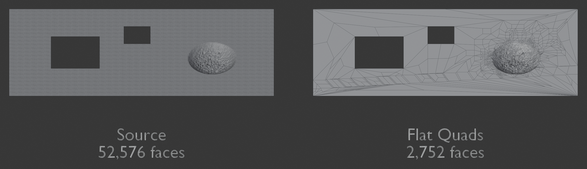
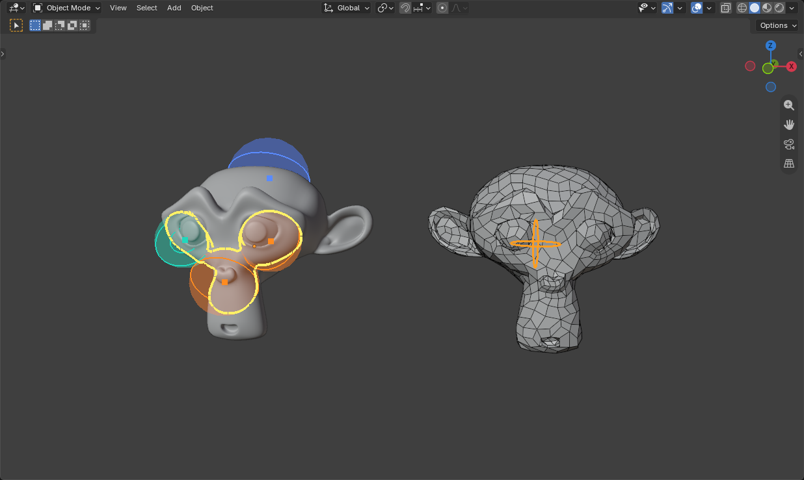
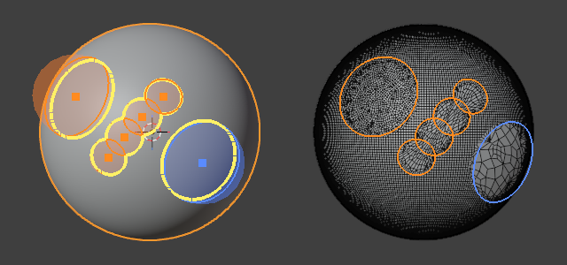
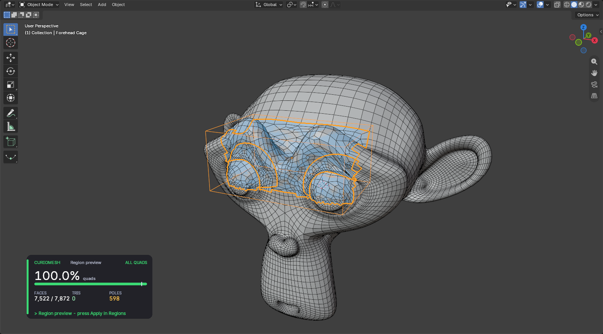
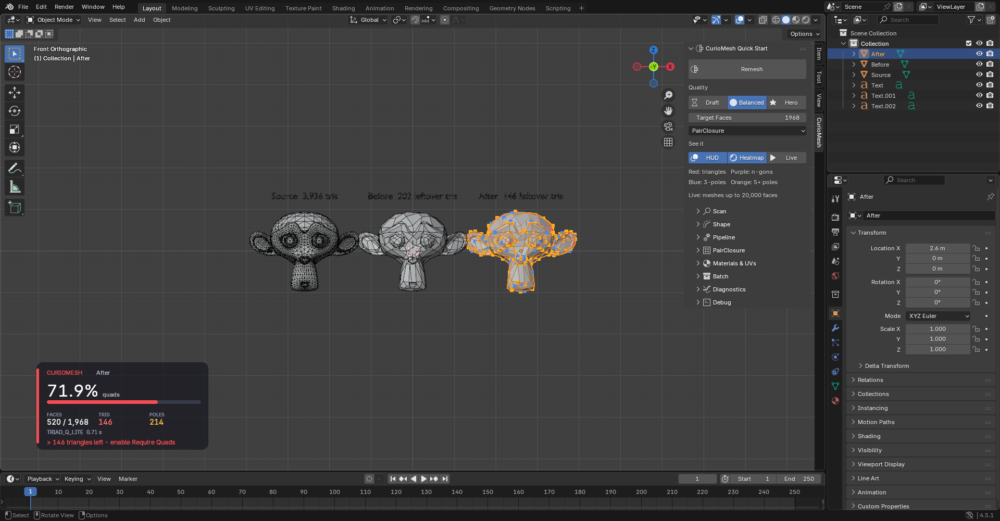
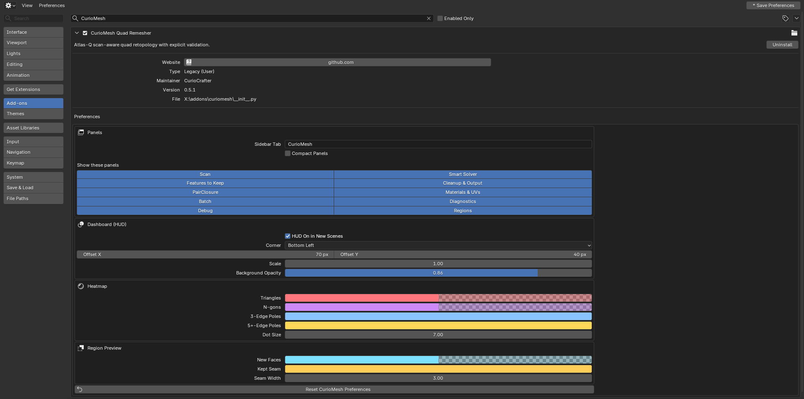
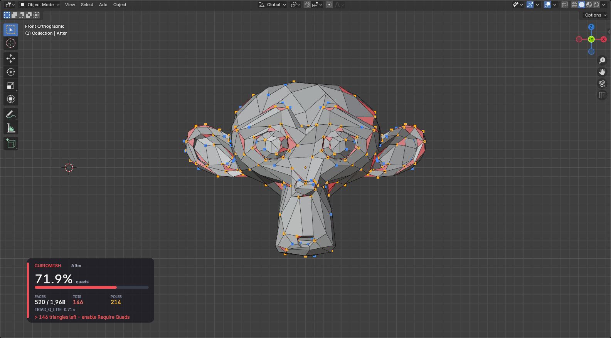
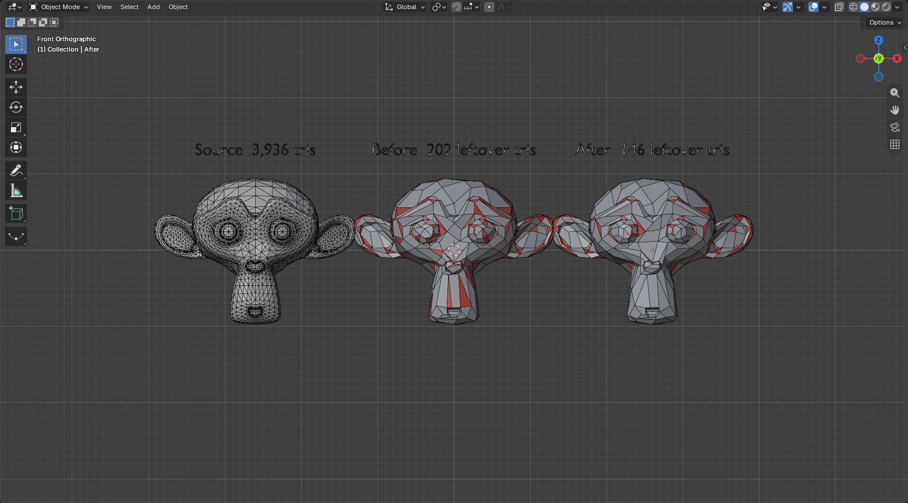

# Older features: Flat Quads, Guided points, Work Live, Regions and the Turbo core

These were the main features of versions 0.6 to 0.8. They are all still in CurioMesh. They moved here from the README so it can lead with Auto Segments. Release notes are in [CHANGELOG.md](../CHANGELOG.md).

## Flat Quads: Huge Quads On Flat Areas, Density Only Where It's Needed

Pick **Flat Quads** as the Method. Instead of giving a whole mesh one density,
it finds the flattest areas, turns each into as few quads as its outline allows,
and grades density back up only next to real detail. It works best on
hard-surface panels and architecture.

A generated test deck: **52,576 faces become 2,752 quads.** Both hatches stay
open, and the faces go to the damage. A plain flat plate becomes **one quad**,
and a subdivided box of 9,600 faces becomes **six**.

How it works:

1. **Grow flat regions**, largest faces first, and merge neighbours whose shared
   plane still fits every vertex, so scan noise can't break up a plate.
2. **Simplify each border once**, so the two regions sharing it always agree and
   no gaps can open.
3. **Rebuild each region from its outline**, keeping holes. A border next to kept
   detail stays dense, and density falls off with distance from it.
4. **Pair and close.** Every valid pair is accepted, because a leftover triangle
   costs three or more quads. Each loose piece closes on its own, so one bad
   fragment can't make the rest of the mesh pay.

**Flatness** sets how far a surface may bump away from flat, as a percent of the
mesh size. The face target is a limit for what's left after the flat areas: a flat
plate stays one quad whatever the target is. On very dirty scans the result can
land above the target.

It also opens non-manifold edges, flipped normals and bow-ties into borders
without moving any geometry, so dirty meshes that fail in Atlas-Q and PairClosure
can still finish all quads.

## New in 0.7: Guided Retopo

Tell CurioMesh where shape matters and watch the quads follow. Open the
**Guided** panel in the CurioMesh tab:

1. **Choose a preset and place points.** Pick Character, Hard-Surface Prop,
   Scan or Game LOD, press **Place Points** and click the mesh. Scroll sets the
   radius, Shift+scroll the strength, keys 1-4 the type, Ctrl+click removes a
   point, Enter or Esc finishes. **Auto-suggest** places points at high
   curvature, hard edges and small holes for you.
2. **Watch the live preview.** Each point's reach and the combined outline are
   drawn on the mesh, and a preview beside it updates as you edit. **Whole
   Mesh** remeshes everything with the points changing the quad size; **Points
   Only** rebuilds just the inside of the point spheres and leaves the rest
   exactly as it is.
3. **Lock, redraw, apply.** Lock faces you like, rebuild a selected strip with
   **Redraw Strip**, and follow **Next spot** to the weakest area. Nothing
   changes until you press **Apply**, which writes a new `_Retopo` object or
   replaces your mesh (Undo restores it).

| Point | What it asks for |
|---|---|
| Detail | More, smaller quads around the point |
| Loop | Edge loops that ring around the point: eyes, mouths, elbows |
| Sharp | Smaller quads and hard edges kept |
| Calm | Fewer, bigger quads; also cuts a hole in a Points Only region |

Points can also be sphere Empties you move and scale like any object. Good to
know:

- Whole Mesh results are all quads by default. **All Quads** in Advanced turns
  that off for a faster preview of big meshes; a few triangles then stay.
- UV layers and materials carry over from your mesh in both modes. A quad
  crossing a UV seam takes its UVs from one side, so it does not stretch across
  the atlas. **Keep UV Seams** in Auto Segments goes further: quads stay inside one
  UV island, and seams stay in place, straightened only slightly. It's off by default
  because a model cut into many islands needs more faces for this, up to about twice
  as many on our test models. For textured game assets, Bake Detail **Normal + Color**
  is the recommended route.
- **Bake Detail**, next to Apply, bakes your mesh onto the result. **Normal Map**
  keeps your materials and adds a normal map. **Normal + Color** makes one new
  material and new UVs. Press Update after choosing it: seams then cost no faces.
  Your mesh is only read. Baking blocks Blender until it's done, and it reads the
  surface nearest to each texel, so parts that touch can bleed into each other.
  Only the normal map and base color are baked, not roughness or metal. If your
  UVs overlap themselves, Normal Map adds a second UV map for the normal map, and
  most game engines need to be told to read it.
- Applied results keep edges sharper than 60 degrees hard. Baking also makes UV
  seams hard and adds a Triangulate modifier, so the exported triangles match the
  bake. Export with modifiers applied, which glTF doesn't do by default. Your
  quads stay underneath: turn the modifier off to export them to FBX.
- A Points Only region that wraps a limb or surrounds an open hole is cut into
  pieces that are each rebuilt, so the whole ring gets new quads. The cut stays
  as a line of kept edges between the pieces.
- Points Only keeps your mesh's edges on the region's border, so a very dense
  mesh gets a dense band of quads along that border.
- A preview that takes more than 4 seconds stops updating by itself until you
  press **Update**, so Blender stays usable on big meshes.

### Work Live: retopo area by area, next to the algorithm

Press **Work Live** in the Guided panel and work over the mesh while it
remeshes in the background. Blender stays yours between steps, and the result
beside your mesh fills in one finished piece at a time.

| Do this | Over your mesh or the result |
|---|---|
| Click or drag | Add an area. A drag paints one stroke |
| Scroll | Size of the area under the mouse, or of the next one |
| Shift+scroll | Density: up is more quads. Below the base density Detail turns into Calm |
| F | Fill style of that area: Flow or Grid |
| Ctrl+click | Remove the area |
| Enter, Esc or right-click | Finish. **Apply** writes the result |

- A pulsing ring shows which area the algorithm is on. The area you touched last
  goes first.
- Only what changed is redone: the other areas stay on screen, a change stops
  work that is already out of date, and going back to an earlier setting is
  instant.
- Each area has its own density and fill style, and overlapping areas with the
  same settings become one. Where different areas overlap, the newest wins, and
  a line of your mesh's edges stays between them.
- Everything outside the areas stays as it was. For a full retopo, cover the
  mesh with areas or use Whole Mesh.
- Very large areas still take a while to finish, but you can keep working while
  they run. The Whole Mesh and Points Only modes work as before.

## New in 0.6

| | 0.5 | 0.6 |
|---|---|---|
| What gets remeshed | The whole object | The whole object, or any region you pick |
| Picking a region | n/a | Edit-mode selection, face set, vertex group, box cage, lattice cage, any closed mesh as a volume |
| Combining regions | n/a | Union, Subtract and Intersect, applied top to bottom |
| Joining the patch back | n/a | Seam vertices are kept exactly; the patch is all quads inside |
| Fixing holes | By hand | **Fill Loop** fills a closed hole with quads that follow the surrounding curve |
| Snapping to the original | Shrinkwrap at the end of a run | **Fit to Surface**: relax and snap any mesh or selection back onto the source |
| Panels | One long Quick Start list | Numbered steps, one main button per panel, a Last Result box, plain-language tooltips on every option |
| Look and layout | Fixed | Preferences for tab name, compact mode, hidden panels, HUD corner/size/opacity and every overlay colour |
| Speed | Python and NumPy | **Turbo core in Rust** on all CPU cores: topology checks and quad closing about 30x faster, a 50k-face all-quad remesh 4.5x faster |
| Downloads | Two zips | A zip for each Blender version from 3.6 to 5.2, plus two all-in-one zips |

### Region retopology

Open the **Regions** panel in the CurioMesh tab and work through its three
steps:

1. **Pick the part to redo.** Selection, Face Set, Vertex Group or Cages. Add a
   Box Cage or a Lattice Cage and move, scale or bend it like any object. A
   lattice can follow a curved limb. Any closed mesh also works as a volume.
2. **Choose the new quads.** *Flow* follows the shape. *Grid* lays a tidy grid
   and is best on four-sided patches such as panels and strips. Set the quad
   size.
3. **Preview, then apply.** New faces show tinted blue and the kept seam in
   orange. With Auto-Update on, the preview follows the cage as you move it.
   Apply writes into the mesh or into a copy, and it can be undone.

**Fit to Surface** relaxes and snaps vertices back onto the original surface;
in Edit Mode it only moves your selection. **Fill Loop** turns a selected hole
border into an all-quad patch.

How the region tools work:

- An all-quad patch needs an even number of seam edges. CurioMesh checks this
  and grows or shrinks the region by one face when the count is odd.
- Cages and mesh volumes use the generalized winding number (Jacobson et al.
  2013), so the inside test still works on meshes with holes or overlaps.
- The patch is laid out with a Tutte embedding, filled with a Coons grid for
  four-sided regions or with the TRIAD-Q engine for everything else, and closed
  to all quads with ParityPath while the seam vertices stay fixed.
- Quad size blends from the seam's edge length to your target over a falloff
  distance, so the patch does not jump in density at the border.
- On jagged borders a **Border Ring** of quads runs along the seam, and an
  untangling pass reshapes any bent quad with the seam held still. On a large organic
  scan this cut bent or caved-in quads from about 5% to 0.5%, and on a noisy
  scan from about 31% to 2.8%.
- **Flow: Along Curvature** (Advanced) lines quads up with the surface's main
  bending directions as well as its sharp edges. The same option is in the
  PairClosure settings for whole-mesh runs.

### Turbo core

The slowest steps now run in native Rust code on every CPU core: topology
checks, quad closing, ParityPath search, cross-field smoothing and the cage
inside test. Every zip carries the Turbo core for Windows, Linux, macOS Intel
and macOS Apple Silicon, and it gives the same results as the Python code
(checked by tests on every release).

| Step | Python | Turbo |
|---|---|---|
| Topology check, 500k faces | 49 s | 1.9 s |
| Quad closing, 500k faces | 527 s | 16 s |
| Cage inside test, 20k points | 11 s | 0.08 s |
| Whole remesh, 50k faces, all quads, 8 seeds | 587 s | 129 s |

If the Turbo core cannot load (an antivirus blocks it, or an unusual
platform), CurioMesh falls back to Python automatically. Set the environment
variable `CURIOMESH_TURBO=0` to force Python.

### A friendlier panel you can adjust

Every setting now has a plain name and a tooltip that explains it. After each
run the **Last result** box shows quad percentage, faces, leftovers and time,
or tells you why a run failed. Open the gear in the Quick Start header for the
preferences:

### The viewport dashboard and heatmap

The HUD shows quad percentage with a 95% goal mark, faces against your target,
leftover triangles and poles, and a status word (ALL QUADS, CLEAN, FAIR or
NEEDS WORK), so you can read it without relying on colour. The heatmap colours
leftover triangles, n-gons and poles on the mesh without touching its materials;
5+ poles draw larger as well as in a different colour.

Older release notes are in [CHANGELOG.md](../CHANGELOG.md).
