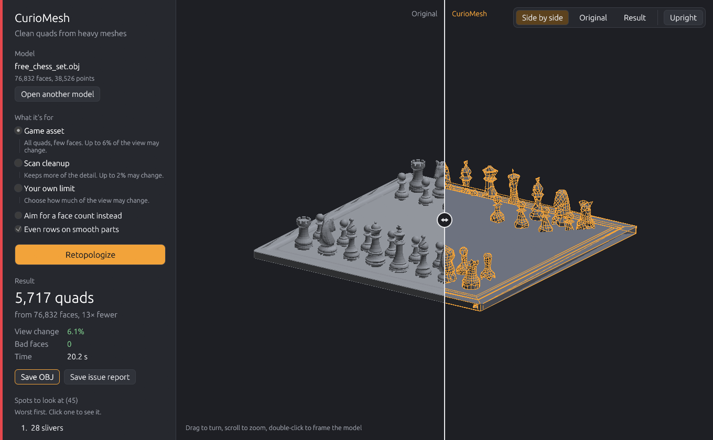

# CurioMesh Standalone

Turn a heavy scan, CAD export or sculpt into a clean all-quad mesh, without Blender. You choose how much of the
model's look may change, and CurioMesh keeps the fewest faces that hold it. Then it tells you where the result
still needs a look.



This is a preview of the standalone version of [CurioMesh](https://github.com/CurioCrafter/CurioMesh), the free
retopology add-on for Blender. It runs the add-on's own Rust core.

## Get it

Download the zip for your system from the
[releases page](https://github.com/CurioCrafter/CurioMesh/releases?q=standalone), unpack it anywhere and start
**curiomesh-gui**. Nothing to install.

- **Windows:** `curiomesh-gui.exe`. Windows may warn about an unknown publisher the first time, because the
  preview isn't code-signed. Choose More info, then Run anyway.
- **macOS:** right-click `curiomesh-gui`, choose Open, then Open again (the preview isn't notarized).
- **Linux:** `./curiomesh-gui`. Needs OpenGL and X11 or Wayland.

## Use the app

1. **Open a model.** Drop an OBJ, glTF, GLB or PLY file on the window, or click Open a model. You can also drop the
   file on the program's icon.
2. **Say what it's for.** Game asset keeps few faces and lets up to 6% of the view change. Scan cleanup keeps
   more detail (2%). Your own limit sets any other share, and Aim for a face count asks for a number of faces
   instead.
3. **Retopologize.** A model of 50,000 to 100,000 faces takes a few seconds to a minute.
4. **Compare.** Drag the line across the model to see the original on the left and the new quads on the right.
   Drag anywhere else to turn the model, scroll to zoom, double-click to frame it again.
5. **Check the spots.** The list shows places worth a look, worst first: slivers, faces at poles and bent quads.
   Click one to fly to it and see its faces in red.
6. **Save OBJ.** Save issue report writes the same list as JSON.

## How much may the view change?

CurioMesh looks at the model from six sides, before and after, and counts the pixels where the outline, the depth
or the direction of the surface differs. That share is the view change. Game asset allows 6%, which keeps
silhouettes and hard edges while flat and gently curved areas become large quads. Lower numbers keep more faces.

Bad faces are faces on broken edges, flipped or duplicated faces, and quads bent past 60 degrees or folded. A good
result has none.

## Use the command line

`curiomesh` does the same work in scripts and asset pipelines.

```
curiomesh model.glb -o model_low.obj --use game-asset --report issues.json
curiomesh scan.ply -o scan_low.obj --reduce-to 5000
curiomesh measure model.glb any_retopo.obj --max-loss 6 --max-bad 0
```

| Option | What it does |
|---|---|
| `--detail P` | Keep the fewest faces whose view changes by at most P percent. Default 6. |
| `--use game-asset` or `--use scan` | The app's presets: 6% or 2%. |
| `--reduce-to N` | Aim for about N faces instead. |
| `--report FILE.json` | Write the numbers and the issue spots as JSON. |
| `--no-rows` | Keep every part as reduced; don't try even rows of quads on smooth parts. |
| `--cpu` | Draw the camera pictures on the processor instead of the graphics card. |

`curiomesh measure SOURCE RESULT` scores any retopology against its source: one made by CurioMesh, by another tool
or by hand. It prints the view change, the bad faces and the worst spots. With `--max-loss` or `--max-bad` it exits
with code 1 when the result is over the limit, so a build can stop on a broken asset.

## How it compares

All measured with `curiomesh measure` on three free models from the CurioMesh test set, at about the same face
count. AutoRemesher 1.2.0 ran with its default settings.

| Model | AutoRemesher 1.2.0 | CurioMesh Standalone |
|---|---|---|
| Chess set | 8,974 faces, 8.3% view change, 113 bad faces | 9,491 faces, 4.7% view change, 0 bad faces |
| Drill press | 15,455 faces, 32.8%, 1,219 bad | 16,716 faces, 8.2%, 0 bad |
| Fire hydrant | 17,335 faces, 20.6%, 462 bad | 18,920 faces, 10.2%, 0 bad |

On these three, CurioMesh keeps much more of the shape on hard-surface parts, and its results have no broken or folded faces.
AutoRemesher's quads are more even: on smooth, organic models its rows of quads are cleaner. CurioMesh lays even
rows only on smooth parts where they keep the view, and keeps the shape-preserving reduction elsewhere. CurioMesh's
results here have 5-9% more faces.

## Known limits of the preview

- The Blender add-on still does more: part-by-part sizing, guided edge loops, UVs, baking, repair and Redo Rough
  Spots. The standalone writes OBJ only, without UVs.
- Quad flow on organic models is less even than a field-aligned remesher's.
- Large models draw thinned out in the viewport; the saved result is complete.

## Licence

GPL-3.0-or-later, like the add-on. Source: the `standalone` branch of
[CurioCrafter/CurioMesh](https://github.com/CurioCrafter/CurioMesh/tree/standalone).
