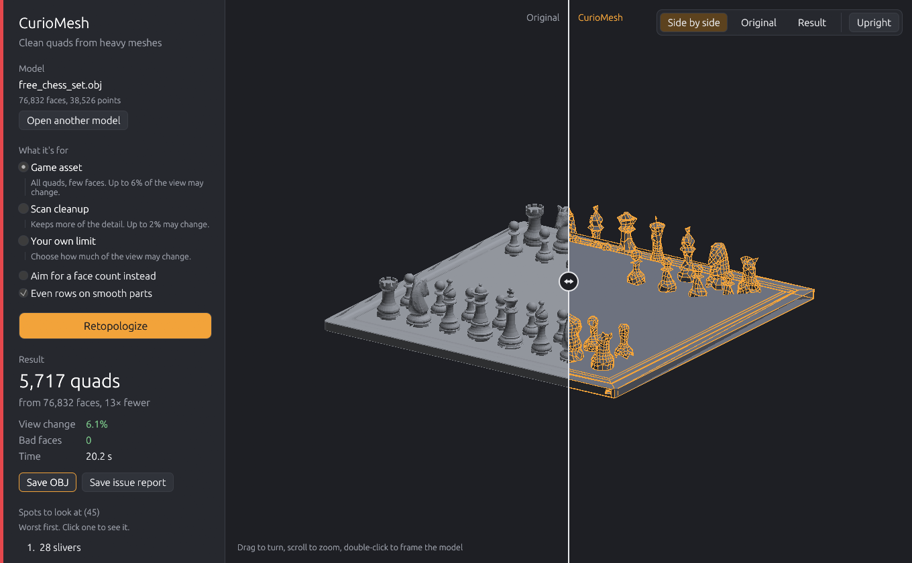
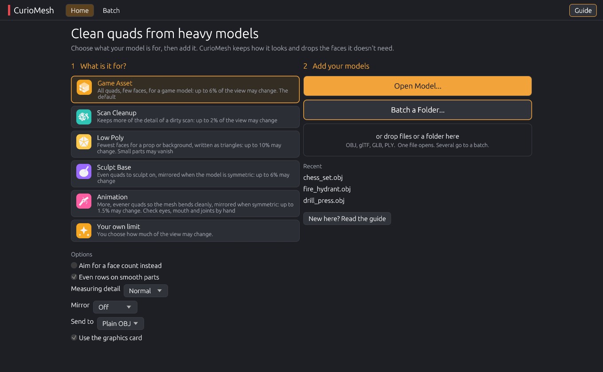
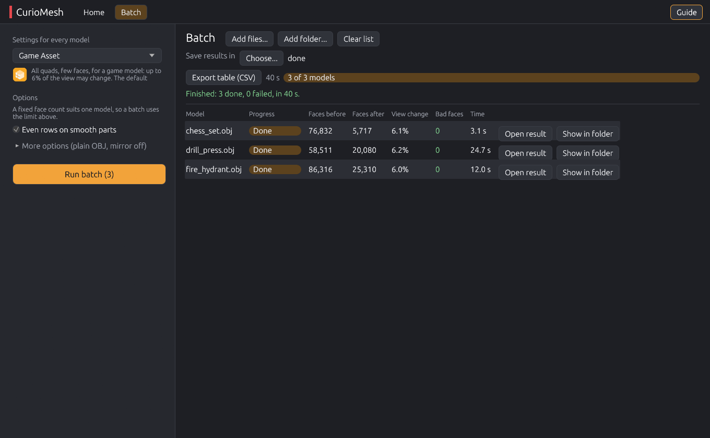

## Clean quads from heavy models, without Blender

CurioMesh Standalone 0.3.0 is the first full release of the CurioMesh desktop app. It turns heavy scans, CAD exports and sculpts into clean all-quad meshes. You say what the model is for, it keeps how the model looks, and it tells you plainly whether the result is ready.

### Which file do I download?

| Your computer | Download | Start |
|---|---|---|
| Windows 10 or 11 | `CurioMesh-0.3.0-windows-x64.zip` | `curiomesh-gui.exe` |
| Any Mac (Apple silicon or Intel) | `CurioMesh-0.3.0-macos-universal.zip` | right-click `curiomesh-gui`, Open |
| Linux (x64) | `CurioMesh-0.3.0-linux-x64.zip` | `./curiomesh-gui` |

Unpack the zip anywhere and start the app. Nothing to install. Each zip also holds `curiomesh`, the command line, and a short guide.

### What it does

**Start by saying what it's for.** Game Asset, Scan Cleanup, Low Poly, Sculpt Base, Animation or your own limit on how much of the view may change. The app remembers your choice and your recent models.

**Compare and get a verdict.** Drag the line across the model to see the original and the new quads side by side. A green, amber or red mark says where you stand ("Good for game asset", "Check 2 spots", "5 spots with bad faces left") with the next step under it. It uses the same rules as the Blender add-on's panel. Click a spot in the list to fly to it.

**Batch a whole folder.** Every model gets the same settings, a bar of its own and a row in the results table: faces before and after, view change, bad faces and time. Export the table as CSV, or open any result to compare it.

**Ready for game engines.** Send to Unreal, Unity, Godot, Roblox or glTF writes the right file type, triangulates when the engine wants triangles, and splits meshes over Roblox's 20,000-triangle limit. Mirror Auto makes both halves of a symmetric model identical.

**For pipelines.** `curiomesh batch models/ -o done/`, settings files and presets, `curiomesh sizes model.glb` to compare seven quad sizes, and `curiomesh measure` to score any retopology against its source and stop a build on a bad one.

### New in 0.3.0

- Up to date with CurioMesh 0.9.8: its verdict, its icons for each use, and a calmer side panel with the rarely changed options under More options.
- One Mac download for Apple silicon and Intel.
- When a rough scan needs nearly every face to stay within the limit, the result now says "Kept nearly every face" with what to try instead.
- Small fixes: the first-run tour no longer covers the open guide, and the result no longer says "1× fewer".

### Tested

The Game Asset preset on 22 free test models, from a 4,000-face sofa to a 1.5-million-face cliff scan: no crashes, 0 bad faces on every model, each within its 6% limit. A few of them:

| Model | Before | After | View change | Time |
|---|---|---|---|---|
| Chess set | 76,832 faces | 5,717 quads | 6.1% | 3 s |
| Concrete road barrier | 60,928 faces | 2,678 quads | 5.1% | 3 s |
| Treasure chest | 103,330 faces | 5,737 quads | 5.4% | 21 s |
| Marble bust | 17,456 faces | 7,038 quads | 4.8% | 8 s |
| Fire hydrant | 86,316 faces | 25,310 quads | 6.0% | 12 s |

At the same face counts as AutoRemesher 1.2.0, CurioMesh kept more of the shape on all three models compared (drill press: 8.2% of the view changed against 32.8%) and left 0 bad faces where AutoRemesher left 113 to 1,219. AutoRemesher's quads are more even on smooth, organic shapes. Every number here was measured with `curiomesh measure`.

### Good to know

- The Blender add-on still does more: UVs, baking, guided edge loops, part-by-part fixes and Tidy Up.
- Rough scans can keep most of their faces at a small limit, because the camera sees every bump turn. Low Poly, a higher limit or a face count reduce them.
- The programs aren't code-signed yet, so Windows and macOS ask once before the first run. On Windows choose More info, then Run anyway.
- Opens OBJ, glTF, GLB and PLY. Saves OBJ, or GLB for engines that read glTF.
- Check a download against `SHA256SUMS.txt`.

Free and open source under GPL-3.0-or-later. Something wrong or missing? [Open an issue](https://github.com/CurioCrafter/CurioMesh/issues).
