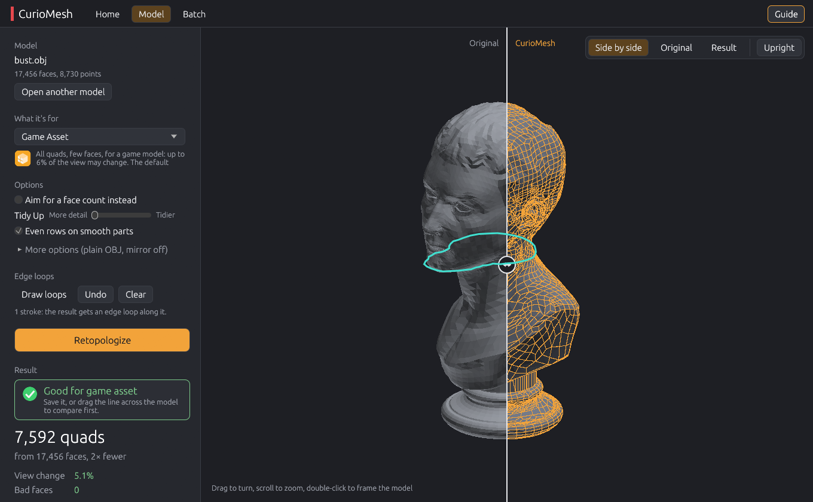
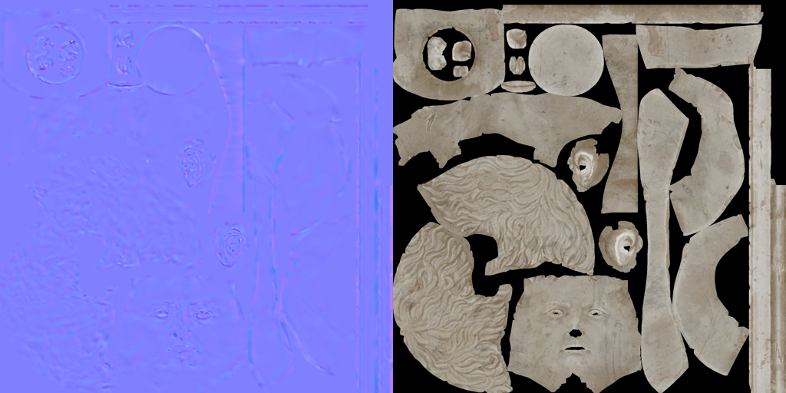

## Bake it, fix it, guide it

CurioMesh Standalone 0.4.0 does the jobs that used to need Blender. The result keeps the model's UVs and gets a baked normal and colour map. You can draw the edge loops it must follow, tidy its poles, fix one bad spot without redoing the whole model, and turn a rough scan into a few thousand quads.

### Which file do I download?

| Your computer | Download | Start |
|---|---|---|
| Windows 10 or 11 | `CurioMesh-0.4.0-windows-x64.zip` | `curiomesh-gui.exe` |
| Any Mac (Apple silicon or Intel) | `CurioMesh-0.4.0-macos-universal.zip` | right-click `curiomesh-gui`, Open |
| Linux (x64) | `CurioMesh-0.4.0-linux-x64.zip` | `./curiomesh-gui` |

Unpack the zip anywhere and start the app. Nothing to install. Each zip also holds `curiomesh`, the command line, and a short guide.

### What's new

**Keeps the UVs and bakes the maps.** Keep the UVs (More options, or `--keep-uvs`) gives the result the original model's UVs, so its textures fit. Bake writes a normal map of the original's surface detail and its colour texture onto the result, as PNGs next to an OBJ or packed into a GLB. On the free marble bust, 7,038 quads take 0.7 s to bake at 2048.

**Scans: judge as baked.** A rough scan used to keep nearly all its faces, because the camera saw every bump turn. With Judge as baked (on in Scan Cleanup, or `--baked`), bumps a normal map will paint back don't count. Game Asset: a boulder scan from 97,964 faces to 1,847 quads, a cliff scan from 1.5 million to 991.

**Draw your edge loops.** Turn on Draw loops and drag on the model: round an eye, a mouth, a neck. The result runs an edge loop along each stroke and says how closely it follows. A loop round the bust's neck lands within 0.5% of the model's size at the worst point.

**Tidy Up.** A slider from "More detail" to "Tidier" redraws the messy patches round poles as plain grids. Poles on the marble bust: 2,521 to 909. On a lion head: 8,020 to 3,311. It is kept only while the view changes at most 1 point more.

**Fix one spot.** Pick a spot from the list and choose Redo this spot (smaller quads that follow the original) or Keep original here (the original's own faces back). Keep original shows what it adds and asks first. Put back undoes the fix. Nothing outside the spot moves.

**Fewer faces for the same look.** Without Blender to keep responsive, the search keeps going until the result is within 2% of your limit instead of 10%. On five of eight test models that gave 1 to 15% fewer faces, for example a concrete barrier from 2,678 to 2,277 quads.

### Tested

The Game Asset preset on 22 free test models, from a 4,000-face sofa to a 1.5-million-face cliff scan: no crashes, 0 bad faces on every model, and every result within its limit (up to 110% of 6%, the add-on's own allowance).

### Good to know

- UVs and baking need a model that has UVs: CurioMesh doesn't unwrap.
- Redo this spot can't fix spots on broken edges of the original. It makes the quads smaller, so it doesn't remove slivers or poles; Tidy Up does that.
- Strokes you draw show through the model, and rows of loops beside a stroke aren't made yet.
- The programs aren't code-signed, so Windows and macOS ask once before the first run. On Windows choose More info, then Run anyway.
- Check a download against `SHA256SUMS.txt`.

Free and open source under GPL-3.0-or-later. Something wrong or missing? [Open an issue](https://github.com/CurioCrafter/CurioMesh/issues).
